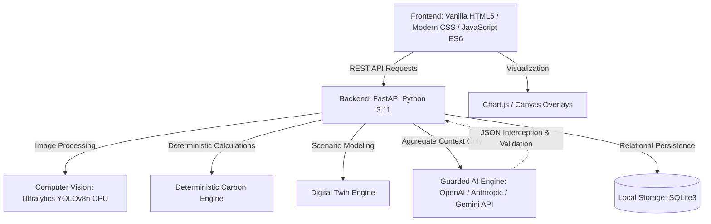

# CarboSync / TraceTwin: Campus Commute Emissions Intelligence Platform

> **Tagline:** See the traffic. Trace the carbon. Test the fix.

---

## 1. Executive Summary

**TraceTwin** (project repository **CarboSync**) is an environmental data intelligence platform designed for university campuses to quantify, analyze, and simulate interventions for commute-related vehicular carbon emissions. 

Universities generate significant indirect Scope 3 greenhouse gas (GHG) emissions through daily student, faculty, and administrative staff transit. However, campus planners and sustainability teams face three persistent obstacles:
1. **The Invisibility of Commute Activity:** Commute data is fragmented across physical parking lots, disconnected student registers, and sporadic surveys.
2. **Methodological Confusion:** Audits frequently confuse snapshot parking observations with total daily unique commuters, misapply passenger-level emission factors to vehicle-kilometres, or rely on unsupported extrapolations.
3. **Inability to Test Interventions Before Implementation:** Campus administrators lack accessible "Digital Twin" simulation tools to evaluate the real-world carbon impact of policies—such as carpooling incentives, institutional shuttles, or hybrid schedule adjustments—prior to committing capital and operational resources.

TraceTwin resolves these challenges through an integrated, defensible five-stage workflow:
$$\text{Campus Parking Photos} \longrightarrow \text{Pretrained CV Detection} \longrightarrow \text{Human Verification} \longrightarrow \text{Deterministic Carbon Engine} \longrightarrow \text{Digital Twin Scenarios} \longrightarrow \text{Guarded AI Explanations}$$

### The Core Architectural Principle
> **AI may detect objects and explain results, but deterministic calculations and documented emission factors must control all numerical emissions claims.**

---

## 2. Event & Critical Hackathon Compliance

| Attribute | Specification |
| :--- | :--- |
| **Event** | Dayananda Sagar University Code Clash 2.0 Hackathon |
| **Dates** | October 15–16, 2026 |
| **Track** | Carbon Footprint Intelligence Platform |
| **Target Deployment** | Single local laptop (self-contained local execution) |
| **Primary Audience** | Hackathon evaluators, campus sustainability committees, university facility planners |

### Critical Hackathon Constraint
The official event website states that **all code must be written during the event** and that **pre-built projects or templates are strictly prohibited**.

In full adherence to these regulations:
- This repository prior to competition kickoff contains **exclusively planning, architecture specifications, mathematical methodologies, data contracts, and verification plans**.
- **Zero executable application code, pre-built templates, or hidden scripts exist.**
- 100% of functional application code (FastAPI backend, YOLO inference pipeline, interactive Canvas review interface, SQLite database, and Chart.js dashboards) will be authored live during the official 48-hour hackathon window.
- **AI Coding Assistance:** While AI coding tools are permitted as collaborative pair-programmers during the hackathon, their output is strictly bounded to live hackathon hours and must be reviewed, tested, and integrated by the team.

---

## 3. Scope & Baseline Boundaries

To maintain scientific credibility and deliver an airtight 48-hour minimum viable product (MVP), TraceTwin enforces strict scope boundaries:

### Supported Vehicle Categories
1. **Cars** (Personal passenger automobiles, internal combustion engines)
2. **Motorcycles and scooters** (Two-wheelers powered by petrol)
3. **Buses and campus shuttles** (Contracted institutional coaches and public transit buses)
4. **Other fuel-burning vehicles, including auto-rickshaws** (Three-wheelers and utility vehicles)

### Explicit Baseline Exclusions
- **Electric Vehicles (EVs):** Excluded from the initial baseline calculation. Incorporating EVs requires grid-carbon intensity data (e.g., Central Electricity Authority emission factors) and charging behavior models that fall outside the 48-hour core scope.
- **Walking & Cycling:** Non-motorized active transit produces zero tailpipe emissions. While active transport is noted as a desirable target state, it is excluded from emissions accounting to avoid artificial baseline distortion.
- **Lifecycle & Upstream Emissions (Well-to-Tank):** The MVP strictly calculates **direct tailpipe greenhouse gas emissions ($CO_2$)**. Full lifecycle assessment (LCA) and upstream fuel refining emissions are explicitly documented as out of scope.

### Three Digital Twin Scenarios
1. **Fewer Commute Days:** Modeling remote learning or compressed academic work-weeks.
2. **Carpooling:** Increasing car occupancy with a 10% route detour penalty ($D_{\text{detour}} = 1.10$).
3. **Institutional Bus / Campus Shuttle:** Shifting private commuters while **mandatorily calculating and displaying the operating shuttle's added diesel fuel emissions**.

---

## 4. Complete Project Documentation Index

All planning, architectural, and mathematical specifications are organized inside [`TraceTwin_Documentation/`](TraceTwin_Documentation/):

| Document | Purpose & Core Contents |
| :--- | :--- |
| 📋 [PRD.md](TraceTwin_Documentation/PRD.md) | Product Requirements Document: problem statement, personas, functional requirements (FR-1 to FR-8), NFRs, MoSCoW priorities, and all 14 critical project risks. |
| 🏗️ [SPECIFICATIONS.md](TraceTwin_Documentation/SPECIFICATIONS.md) | Technical architecture, YOLOv8n CPU pipeline, Canvas human-in-the-loop review, pure-Python deterministic engine, REST API contracts, and SQLite schema. |
| 🧠 [CONTEXT.md](TraceTwin_Documentation/CONTEXT.md) | Developer context, invariant mathematical rules, privacy boundaries, 6 evidence labels, and AI assistant behavior guidelines. |
| 📊 [STATUS.md](TraceTwin_Documentation/STATUS.md) | Living project status register: stage certification (0 lines of code, 0 tests run), confirmed decisions, proposed features, and audit trail. |
| 🏛️ [DECISIONS.md](TraceTwin_Documentation/DECISIONS.md) | 13 formal Architectural Decision Records (ADRs) covering single-laptop hosting, vehicle classes, factor provenance, and guarded AI fallback. |
| 📚 [DATA_DICTIONARY.md](TraceTwin_Documentation/DATA_DICTIONARY.md) | Conceptual entity definitions (Assessment, ParkingObservation, DetectionAndCorrection, CommuteInput, EmissionFactor, Scenario, AIRecommendation) with zero student PII. |
| 🔬 [METHODOLOGY.md](TraceTwin_Documentation/METHODOLOGY.md) | Carbon accounting methodology: tailpipe $\text{kg } CO_2$ boundary, VKT vs. PKT rules, carpool detours ($D_{\text{detour}} = 1.10$), shuttle added fuel emissions, and anti-double-counting. |
| 🧪 [TEST_PLAN.md](TraceTwin_Documentation/TEST_PLAN.md) | 18 test cases across 11 test suites (CV bounds, hand-calculated benchmarks, unit isolation, AI number stripping, fallback activation, and live E2E demo script). |
| ⏱️ [EXECUTION_PLAN.md](TraceTwin_Documentation/EXECUTION_PLAN.md) | 48-hour roadmap across 4 parallel workstreams (A: CV, B: Engine, C: Frontend, D: Backend/Integration Owner), vertical slice 1, integration checkpoints, and cut lines. |
| 📑 [SOURCES_AND_ASSUMPTIONS.md](TraceTwin_Documentation/SOURCES_AND_ASSUMPTIONS.md) | Emission factor register (India GHG Program, ARAI, CPCB), critical analysis of the CEA grid-factor fallacy, and register of baseline operational assumptions. |
| ✅ [VALIDATION_SUMMARY.md](TraceTwin_Documentation/VALIDATION_SUMMARY.md) | Cross-document consistency verification matrix across all 16 prompt invariants, unresolved technical questions, and kickoff sign-off checklist. |
| 💻 [FRONTEND.md](TraceTwin_Documentation/FRONTEND.md) | Dedicated frontend task breakdown (F-01 to F-10), UI layouts, Canvas editor specs, design tokens, and mock fixtures. |
| ⚙️ [BACKEND.md](TraceTwin_Documentation/BACKEND.md) | Dedicated backend task breakdown (B-01 to B-10), YOLOv8n worker, calculation engine, and REST API routes. |

---

## 5. Proposed Architecture & Technology Stack

> **Status:** `Proposed` (Subject to live setup during hackathon kickoff)

- **Frontend Client:** Lightweight Vanilla HTML5, modern custom CSS (clean dark mode, responsive flex/grid layouts), and native JavaScript (ES6+). Zero heavy frontend frameworks (no React/Next.js/Angular) to guarantee rapid live development, zero build-step overhead, and instant browser debugging.
- **Data Visualizations:** Chart.js for interactive emission breakdown charts and scenario comparisons; HTML5 Canvas for bounding box rendering and human verification.
- **Backend Application Server:** Python 3.11 with FastAPI and Uvicorn. Provides asynchronous request handling, automated OpenAPI documentation, Pydantic type safety, and seamless Python ML integration.
- **Computer Vision Pipeline:** Ultralytics YOLOv8 (nano variant `yolov8n.pt`) executing locally on CPU. Designed for rapid detection of cars, motorcycles, and buses from parking snapshot photographs.
- **Persistence Tier:** SQLite3 running locally via SQLAlchemy ORM or standard Python `sqlite3`. Zero configuration, zero external database daemon.
- **Guarded Generative AI:** API-based LLM (OpenAI GPT-4o-mini, Anthropic Claude 3.5 Haiku, or Google Gemini 1.5 Flash). Enforces strict JSON schemas, receives only aggregate metrics (no PII), and operates behind a deterministic validation gate with an automatic rule-based fallback.

---

## 6. How the Team Should Use This Repository

1. **Pre-Hackathon Preparation:**
   - Review [CONTEXT.md](TraceTwin_Documentation/CONTEXT.md) to internalize the core boundaries, mathematical formulas, and anti-hallucination rules.
   - Review task allocations in [FRONTEND.md](TraceTwin_Documentation/FRONTEND.md) and [BACKEND.md](TraceTwin_Documentation/BACKEND.md).
   - Clarify unresolved items listed in [STATUS.md](TraceTwin_Documentation/STATUS.md) and [VALIDATION_SUMMARY.md](TraceTwin_Documentation/VALIDATION_SUMMARY.md).
2. **Kickoff (Hour 0):**
   - Confirm team workstream assignments as detailed in [EXECUTION_PLAN.md](TraceTwin_Documentation/EXECUTION_PLAN.md).
   - Freeze the shared API contract from [SPECIFICATIONS.md](TraceTwin_Documentation/SPECIFICATIONS.md).
3. **During Live Implementation:**
   - Adhere strictly to the field names and validation rules defined in [DATA_DICTIONARY.md](TraceTwin_Documentation/DATA_DICTIONARY.md).
   - Implement the exact mathematical formulas documented in [METHODOLOGY.md](TraceTwin_Documentation/METHODOLOGY.md).
   - Execute verification tests outlined in [TEST_PLAN.md](TraceTwin_Documentation/TEST_PLAN.md) before declaring features complete.
4. **During the Final Presentation:**
   - Use the methodology disclosures and evidence labeling system to demonstrate scientific maturity and transparency to the evaluators.

---

## 7. Status & Testing Notice

> [!IMPORTANT]
> **Documentation Does Not Equal Implementation or Verification.**
> - All architectural diagrams, API schemas, UI mockups, and database tables described in this repository represent **proposed specifications**.
> - No functional software has been deployed, and no physical tests have been executed prior to the hackathon.
> - As features are built and validated during the active competition, their status will transition from `Proposed` to `Implemented` and `Tested` in [STATUS.md](TraceTwin_Documentation/STATUS.md) only upon provision of verifiable execution evidence.
