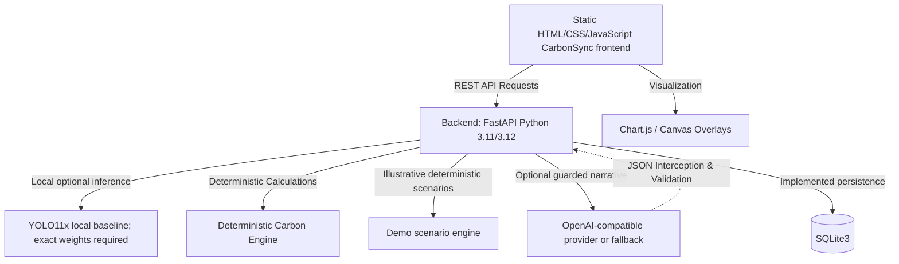

# CarboSync / TraceTwin: Campus Commute Emissions Intelligence Platform

See [DEPLOYMENT.md](DEPLOYMENT.md) for the current hosting shape and deployment blockers. This is a preparation guide; the application is not cleared for public deployment with personal student data.

> **Tagline:** See the traffic. Trace the carbon. Test the fix.

---

## 1. Executive Summary

**TraceTwin** (project repository **CarboSync**) is a campus commute-emissions demo. The repository implements the B1–B3 assessment/calculation backend and a separate illustrative image-analysis demo with local YOLO integration, deterministic scenarios, SQLite snapshots, and guarded optional recommendations. The approved factor registry remains empty; demo results always use explicitly supplied illustrative factors and are never approved production calculations. A local YOLO runtime and weight file are required for actual image inference.

Universities generate significant indirect Scope 3 greenhouse gas (GHG) emissions through daily student, faculty, and administrative staff transit. However, campus planners and sustainability teams face three persistent obstacles:
1. **The Invisibility of Commute Activity:** Commute data is fragmented across physical parking lots, disconnected student registers, and sporadic surveys.
2. **Methodological Confusion:** Audits frequently confuse snapshot parking observations with total daily unique commuters, misapply passenger-level emission factors to vehicle-kilometres, or rely on unsupported extrapolations.
3. **Inability to Test Interventions Before Implementation:** Campus administrators lack accessible "Digital Twin" simulation tools to evaluate the real-world carbon impact of policies—such as carpooling incentives, institutional shuttles, or hybrid schedule adjustments—prior to committing capital and operational resources.

The intended workflow is image analysis, commute activity estimates, scenario comparison, and grounded recommendations. The current repository includes a static CarbonSync dashboard, local YOLO image review, persistent 10-day observation campaigns, private student input forms, deterministic student commute and scenario estimates, report printing, and a guarded recommendation fallback. Emission factors remain provisional; no production inventory or parking-image accuracy claim is established:
$$\text{Campus Parking Photos} \longrightarrow \text{Pretrained CV Detection} \longrightarrow \text{Human Verification} \longrightarrow \text{Deterministic Carbon Engine} \longrightarrow \text{Digital Twin Scenarios} \longrightarrow \text{Guarded AI Explanations}$$

### The Core Architectural Principle
> **AI may detect objects and explain results, but deterministic calculations and documented emission factors must control all numerical emissions claims.**

---

## 2. Event & Critical Hackathon Compliance

| Attribute | Specification |
| :--- | :--- |
| **Event** | Dayananda Sagar University Code Clash 2.0 Hackathon |
| **Dates** | October 15–16, 2026 |
| **Track** | Carbon Footprint Intelligence Platform |
| **Target Deployment** | Single local laptop (self-contained local execution) |
| **Primary Audience** | Hackathon evaluators, campus sustainability committees, university facility planners |

### Critical Hackathon Constraint
The official event website states that **all code must be written during the event** and that **pre-built projects or templates are strictly prohibited**.

The statements in this section describe the original event plan. The current repository now contains backend source and tests; do not use the historical zero-code statement as a current status report. See `TraceTwin_Documentation/STATUS.md` for the current file and test evidence. Any external event-rule compliance question remains for the project team to verify.

---

## 3. Scope & Baseline Boundaries

To maintain scientific credibility and deliver an airtight 48-hour minimum viable product (MVP), TraceTwin enforces strict scope boundaries:

### Supported Vehicle Categories
1. **Cars** (Personal passenger automobiles, internal combustion engines)
2. **Motorcycles and scooters** (Two-wheelers powered by petrol)
3. **Buses and campus shuttles** (Contracted institutional coaches and public transit buses)
4. **Other fuel-burning vehicles, including auto-rickshaws** (Three-wheelers and utility vehicles)

### Explicit Baseline Exclusions
- **Electric Vehicles (EVs):** Excluded from the initial baseline calculation. Incorporating EVs requires grid-carbon intensity data (e.g., Central Electricity Authority emission factors) and charging behavior models that fall outside the 48-hour core scope.
- **Walking & Cycling:** Non-motorized active transit produces zero tailpipe emissions. While active transport is noted as a desirable target state, it is excluded from emissions accounting to avoid artificial baseline distortion.
- **Lifecycle & Upstream Emissions (Well-to-Tank):** The MVP strictly calculates **direct tailpipe greenhouse gas emissions ($CO_2$)**. Full lifecycle assessment (LCA) and upstream fuel refining emissions are explicitly documented as out of scope.

### Three Digital Twin Scenarios
1. **Fewer Commute Days:** Modeling remote learning or compressed academic work-weeks.
2. **Carpooling:** Increasing car occupancy with a 10% route detour penalty ($D_{\text{detour}} = 1.10$).
3. **Institutional Bus / Campus Shuttle:** Shifting private commuters while **mandatorily calculating and displaying the operating shuttle's added diesel fuel emissions**.

---

## 4. Complete Project Documentation Index

All planning, architectural, and mathematical specifications are organized inside [`TraceTwin_Documentation/`](TraceTwin_Documentation/):

| Document | Purpose & Core Contents |
| :--- | :--- |
| 📋 [PRD.md](TraceTwin_Documentation/PRD.md) | Product Requirements Document: problem statement, personas, functional requirements (FR-1 to FR-8), NFRs, MoSCoW priorities, and all 14 critical project risks. |
| 🏗️ [SPECIFICATIONS.md](TraceTwin_Documentation/SPECIFICATIONS.md) | Proposed product architecture, CV pipeline, review interface, calculation engine, future APIs, and persistence design. |
| 🧠 [CONTEXT.md](TraceTwin_Documentation/CONTEXT.md) | Developer context, invariant mathematical rules, privacy boundaries, 6 evidence labels, and AI assistant behavior guidelines. |
| 📊 [STATUS.md](TraceTwin_Documentation/STATUS.md) | Current implementation, test evidence, known issues, and unresolved decisions. |
| 🏛️ [DECISIONS.md](TraceTwin_Documentation/DECISIONS.md) | Architectural Decision Records covering single-laptop hosting, vehicle classes, factor provenance, and guarded AI fallback. |
| 📚 [DATA_DICTIONARY.md](TraceTwin_Documentation/DATA_DICTIONARY.md) | Conceptual entity definitions (Assessment, ParkingObservation, DetectionAndCorrection, CommuteInput, EmissionFactor, Scenario, AIRecommendation) with zero student PII. |
| 🔬 [METHODOLOGY.md](TraceTwin_Documentation/METHODOLOGY.md) | Carbon accounting methodology: tailpipe $\text{kg } CO_2$ boundary, VKT vs. PKT rules, carpool detours ($D_{\text{detour}} = 1.10$), shuttle added fuel emissions, and anti-double-counting. |
| 🧪 [TEST_PLAN.md](TraceTwin_Documentation/TEST_PLAN.md) | Product-wide planned test cases; current executable backend suites and run evidence are listed in `STATUS.md`. |
| ⏱️ [EXECUTION_PLAN.md](TraceTwin_Documentation/EXECUTION_PLAN.md) | 48-hour roadmap across 4 parallel workstreams (A: CV, B: Engine, C: Frontend, D: Backend/Integration Owner), vertical slice 1, integration checkpoints, and cut lines. |
| 📑 [SOURCES_AND_ASSUMPTIONS.md](TraceTwin_Documentation/SOURCES_AND_ASSUMPTIONS.md) | Emission factor register (India GHG Program, ARAI, CPCB), critical analysis of the CEA grid-factor fallacy, and register of baseline operational assumptions. |
| ✅ [VALIDATION_SUMMARY.md](TraceTwin_Documentation/VALIDATION_SUMMARY.md) | Historical pre-implementation consistency review; not current release evidence. |
| 💻 [FRONTEND.md](TraceTwin_Documentation/FRONTEND.md) | Dedicated frontend task breakdown (F-01 to F-10), UI layouts, Canvas editor specs, design tokens, and mock fixtures. |
| ⚙️ [BACKEND.md](TraceTwin_Documentation/BACKEND.md) | Authoritative current API contract, implemented backend behavior, and clearly marked future backend tasks. |
| 🧰 [BACKEND_SETUP.md](BACKEND_SETUP.md) | Portable Windows setup, local YOLO configuration, and React API integration examples. |

---

## 5. Current Backend and Proposed Future Architecture

> The B3 contract and the separate illustrative demo backend are implemented. The current local setup includes a static frontend and a human-editable detection review canvas. Live inference requires the local YOLO model and weights. Evaluation on annotated overhead parking images remains outstanding.

- **Local demo:** Start the frontend at `http://127.0.0.1:5500/` and the loopback-only API at `http://127.0.0.1:8001/`; the step-by-step commands are in [BACKEND_SETUP.md](BACKEND_SETUP.md). Student records are locally persisted; aggregate reports exclude names and home addresses. The recommendation service uses an explicit rule-based fallback when no supported LLM credentials are configured.
- **Evidence limits:** The current YOLO11x model successfully loads, but its zero-detection output on one overhead parking sample demonstrates a limitation; parking accuracy must be measured on a held-out, manually annotated dataset before it is described as reliable. Commute factors remain illustrative and unapproved.
- **Data Visualizations:** Chart.js for interactive emission breakdown charts and scenario comparisons; HTML5 Canvas for bounding box rendering and human verification.
- **Backend Application Server:** Python 3.11 or 3.12 with FastAPI and Uvicorn. Provides asynchronous request handling, automated OpenAPI documentation, Pydantic type safety, and local Python ML integration.
- **Computer Vision Pipeline:** An optional Ultralytics `.pt` service reads the configured model's class names instead of assuming custom weights use COCO IDs. The repository has no model weights; it does not download them. A missing model/runtime produces an actionable safe 503.
- **Persistence Tier:** Standard-library sqlite3 stores assessment/calculation snapshots and structured demo detections, assumptions, scenarios, and recommendation status. Uploaded and annotated images are not persisted.
- **Guarded Generative AI:** Optional OpenAI-compatible API adapter with environment-based credentials, a four-second timeout, response validation, and deterministic fallback. The image is never sent.

---

## 6. How the Team Should Use This Repository

1. **Pre-Hackathon Preparation:**
   - Review [CONTEXT.md](TraceTwin_Documentation/CONTEXT.md) to internalize the core boundaries, mathematical formulas, and anti-hallucination rules.
   - Review task allocations in [FRONTEND.md](TraceTwin_Documentation/FRONTEND.md) and [BACKEND.md](TraceTwin_Documentation/BACKEND.md).
   - Clarify unresolved items listed in [STATUS.md](TraceTwin_Documentation/STATUS.md) and [VALIDATION_SUMMARY.md](TraceTwin_Documentation/VALIDATION_SUMMARY.md).
2. **Contract ownership:**
   - Use [BACKEND.md](TraceTwin_Documentation/BACKEND.md) as the single current API contract.
   - Treat API examples in other documents as proposed mock material unless they match BACKEND.md.
3. **During Live Implementation:**
   - Adhere strictly to the field names and validation rules defined in [DATA_DICTIONARY.md](TraceTwin_Documentation/DATA_DICTIONARY.md).
   - Implement the exact mathematical formulas documented in [METHODOLOGY.md](TraceTwin_Documentation/METHODOLOGY.md).
   - Execute verification tests outlined in [TEST_PLAN.md](TraceTwin_Documentation/TEST_PLAN.md) before declaring features complete.
4. **During the Final Presentation:**
   - Use the methodology disclosures and evidence labeling system to demonstrate scientific maturity and transparency to the evaluators.

---

## 7. Status & Testing Notice

> [!IMPORTANT]
> **Documentation Does Not Equal Implementation or Verification.**
> - Product architecture and future components remain proposed; current implemented routes are listed in [BACKEND.md](TraceTwin_Documentation/BACKEND.md).
> - Source files existing does not prove they ran. [STATUS.md](TraceTwin_Documentation/STATUS.md) records only commands actually executed and their results.

## Local judges' demo backend

For a fresh Windows clone, use [BACKEND_SETUP.md](BACKEND_SETUP.md). The core install does not install the large optional YOLO/PyTorch runtime. If a compatible YOLO environment already exists, the setup and run scripts can use its Python interpreter. No model weights are bundled or downloaded automatically.

The authoritative routes and payload fields are in [`TraceTwin_Documentation/BACKEND.md`](TraceTwin_Documentation/BACKEND.md). `/api/demo/analyze` supports clearly separated real and simulated detection modes. Both produce illustrative, unapproved emissions estimates from explicit assumptions; a parking snapshot does not establish daily traffic or verified campus emissions. Recommendations fall back deterministically when no LLM key is configured.
