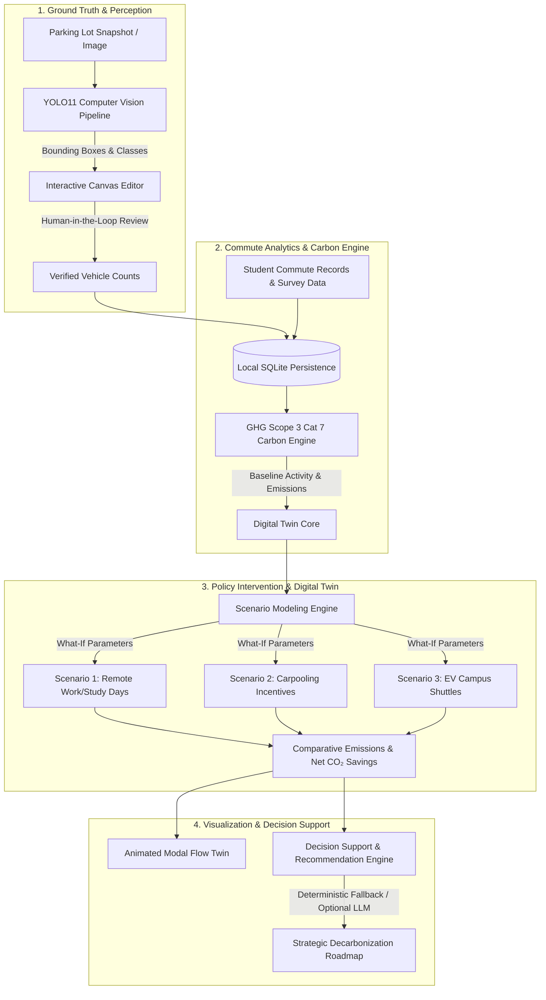

# CarboSync: Campus Commute Emissions Digital Twin

[](tests/)
[](https://www.python.org/)
[](https://fastapi.tiangolo.com/)
[](https://docs.ultralytics.com/)
[](docs/METHODOLOGY.md)
[](docs/DEPLOYMENT.md)

**CarboSync** is an interactive campus commute emissions intelligence platform and digital twin. It bridges physical ground truth with actionable decarbonization policy, combining **local computer vision vehicle detection (YOLO11)**, **human-in-the-loop audit verification**, and a **deterministic greenhouse gas simulation engine** to model and reduce Scope 3 Category 7 (Commuter) emissions.

---

## 🎯 Executive Summary & Problem Statement

### The Challenge
University and enterprise campuses face major hurdles measuring **Scope 3 Category 7 (Employee & Student Commuting)** emissions:
- **Infrequent, Low-Response Surveys**: Annual surveys suffer from self-reporting bias and low response rates.
- **Manual Gate Counts are Prohibitive**: Physical gate-counting across campus gates is expensive, spotty, and error-prone.
- **Black-Box Estimates Lack Auditability**: Automated tools that fabricate numbers or obscure emission factors cannot pass sustainability compliance audits.

### The CarboSync Solution
CarboSync provides an end-to-end, privacy-preserving, local-first workflow:
1. **Visual Ground-Truth Capture**: Converts standard parking lot camera snapshots into vehicle counts using state-of-the-art YOLO11 object detection.
2. **Human-in-the-Loop Audit Gate**: Sustainability officers review, edit, or adjust bounding boxes directly on an interactive HTML5 canvas before locking data into the record.
3. **Deterministic Digital Twin Simulation**: Simulates policy interventions—such as remote learning/work schedules, carpooling incentives, electric campus shuttle routes, and active travel corridors—with instant, mathematically transparent carbon recalculations.
4. **Animated Mode-Flow Twin**: Visualizes real-time modal shifts and traffic flow patterns comparing baseline versus intervention scenarios.

---

## 🏗️ System Architecture & Workflow



---

## ⚡ Quickstart for Judges (Ready in 60 Seconds)

CarboSync is designed to run locally on Windows without complex database servers or external cloud subscriptions.

### Option A: One-Click Windows Launcher (Recommended)
Open Windows PowerShell in the project directory:

```powershell
.\Start-CarboSync.ps1
```

*What this script does:*
1. Validates Python 3.11/3.12 (prompts via `winget` if missing).
2. Sets up a clean project-local virtual environment (`.venv`) and installs pinned dependencies.
3. Automatically creates `.env` with recommended local defaults if not already present.
4. Starts the unified API and serves the frontend dashboard at [http://127.0.0.1:8001/](http://127.0.0.1:8001/).
5. Automatically opens your default web browser.

> [!TIP]
> If Windows blocks local scripts, bypass the execution policy for this run:
> `powershell -ExecutionPolicy Bypass -File .\Start-CarboSync.ps1`

### Option B: Manual Setup & Execution
If you prefer running commands manually:

```powershell
# 1. Install backend dependencies
.\setup_backend.ps1

# 2. Copy default environment settings
if (-not (Test-Path .env)) { Copy-Item .env.example .env }

# 3. (Optional) Install YOLO model for real inference
.\setup_yolo.ps1

# 4. Start the application server
.\run_backend.ps1
```

Access Points:
- 🖥️ **Web Application**: [http://127.0.0.1:8001/](http://127.0.0.1:8001/)
- 🩺 **System & Detector Health**: [http://127.0.0.1:8001/health](http://127.0.0.1:8001/health)
- 📖 **Interactive OpenAPI Documentation**: [http://127.0.0.1:8001/docs](http://127.0.0.1:8001/docs)

---

## 🧭 Judge Evaluation Walkthrough

Follow this 5-minute guided tour to evaluate each core capability of CarboSync:

### 1. Verify Health & Vision Model Status
Open [http://127.0.0.1:8001/health](http://127.0.0.1:8001/health) in your browser.
- When YOLO weights are loaded, the response reports `"detector": {"status": "ready", "name": "yolo11n", ...}` with the exact SHA-256 weights digest.
- If weights are absent, the API reports `"status": "unavailable"` gracefully without crashing or returning fake detections.

### 2. Computer Vision Parking Lot Detection
- Navigate to the **Parking Observation** section in the web app.
- Upload any parking lot photo (JPEG, PNG, or WebP).
- CarboSync runs local YOLO inference, detects vehicle classes (`bicycle`, `car`, `motorcycle`, `bus`, `truck`), calculates normalized coordinates, and renders bounding boxes with confidence scores.

### 3. Human-in-the-Loop Interactive Canvas
- Genuine GHG accounting demands human auditability.
- On the interactive canvas, click on any detected vehicle to inspect or modify its class.
- Click and drag to create new bounding boxes, or click the delete badge on any false positive.
- Click **Lock Observation** to record the human-verified snapshot into SQLite with cryptographic timestamping.

### 4. Commute Activity & Scope 3 Inventory
- Open the **Commute Profile** tab to review registered student/staff commute patterns.
- View one-way distances, days per week, transport modes, vehicle occupancies, and calculated weekly/annual CO₂ footprints.

### 5. Digital Twin Scenario Simulation
- Switch to the **Digital Twin & Interventions** panel.
- Adjust intervention levers:
  - **Remote Study/Work**: 1 to 3 days/week.
  - **Carpooling Adoption**: Percentage increase in shared rides.
  - **Campus Electric Shuttle**: Route frequency, distance, and ridership diversion.
- Observe instant recalculation of tonnes of CO₂ avoided and animated mode-shift twin flows.

### 6. Actionable Decarbonization Recommendations
- CarboSync generates contextual recommendations tailored to your campus's highest-emitting modes.
- Powered by a deterministic local engine (no external API keys required), with optional OpenAI-compatible LLM support.

---

## 🔬 Carbon Accounting Methodology

CarboSync enforces strict scientific transparency. All emission equations adhere to the **GHG Protocol Corporate Value Chain (Scope 3) Standard - Category 7: Employee Commuting**.

### Activity & Emissions Formulation

$$E_{\text{commute}} = \sum_{m} \left( \frac{d_{m} \times 2 \times D_{m} \times W}{\max(1, O_{m})} \right) \times EF_{m}$$

Where:
- $m$: Commuting mode (car, motorcycle, bus, bicycle, walking).
- $d_{m}$: One-way commute distance (km).
- $D_{m}$: Commute days per week.
- $W$: Operating weeks per academic year (default 52 or configured annual operating days).
- $O_{m}$: Vehicle passenger occupancy factor (ensures shared vehicle-km are not overcounted).
- $EF_{m}$: Specific emission factor ($\text{kg CO}_2 / \text{veh-km}$ or $\text{passenger-km}$).

### Default Factor Registry
| Mode | Candidate Factor | Unit | Scope Status | Provenance / Notes |
| :--- | :--- | :--- | :--- | :--- |
| **Car (Private Passenger)** | `0.145` | $\text{kg CO}_2 / \text{veh-km}$ | Illustrative candidate | Fleet average petrol/diesel passenger sedan. |
| **Motorcycle / Scooter** | `0.035` | $\text{kg CO}_2 / \text{veh-km}$ | Illustrative candidate | Light two-wheeler motorized transit. |
| **Bus / Transit Shuttle** | `0.850` | $\text{kg CO}_2 / \text{veh-km}$ | Illustrative candidate | Campus shuttle / transit coach. |
| **Walking** | `0.000` | $\text{kg CO}_2 / \text{p-km}$ | Zero tailpipe scope | Active mobility; zero operational emissions. |
| **Cycling** | `0.000` | $\text{kg CO}_2 / \text{p-km}$ | Zero tailpipe scope | Active mobility; zero operational emissions. |

> [!NOTE]
> All candidate factors are explicitly labeled with their provenance and approval status in API responses. The application distinguishes between point-in-time parking snapshots (spatial sample) and aggregated annual commute surveys.

---

## 🛠️ Technology Stack

| Layer | Technologies & Libraries | Key Highlights |
| :--- | :--- | :--- |
| **Frontend** | Vanilla HTML5, Modern CSS, ES6 JavaScript, HTML5 Canvas | Zero-build architecture, zero framework bloat, rich animations, interactive bounding-box editor. |
| **Backend API** | Python 3.11/3.12, FastAPI 0.143.2, Starlette, Pydantic v2 | High-performance async ASGI architecture, strict input validation schemas, automatic OpenAPI specs. |
| **Computer Vision** | Ultralytics YOLO11 (`yolo11n.pt` default; `yolo11x.pt` supported), PyTorch, Pillow | Local CPU/GPU inference, multi-class vehicle mapping, class-aware NMS, bounded in-memory image processing. |
| **Persistence** | SQLite, WAL-mode persistence | Zero-configuration relational database; audit-trailed assessment and campaign storage. |
| **Simulation** | NumPy, custom deterministic Carbon Engine | Real-time modal shift modeling, scenario comparison, net avoided carbon calculation. |

---

## ⚙️ Configuration Reference (`.env`)

CarboSync is controlled via environment variables. Copy `.env.example` to `.env`:

| Variable | Default Value | Description |
| :--- | :--- | :--- |
| `CARBOSYNC_SERVE_FRONTEND` | `1` | Serve the static frontend dashboard directly from the FastAPI root (`/`). |
| `CARBOSYNC_CORS_ORIGINS` | `http://localhost:5500,http://127.0.0.1:5500` | Explicit allowed browser origins for cross-origin setups. |
| `CARBOSYNC_DATABASE_PATH` | `carbosync.db` | Path to the local SQLite database. |
| `CARBOSYNC_YOLO_MODEL_PATH` | `backend/models/yolo11n.pt` | Path to the Ultralytics `.pt` weights file. |
| `CARBOSYNC_YOLO_CONFIDENCE` | `0.15` | Minimum confidence score threshold for vehicle detection (0.01 – 1.0). |
| `CARBOSYNC_YOLO_IOU` | `0.30` | Non-Maximum Suppression (NMS) intersection-over-union threshold. |
| `CARBOSYNC_YOLO_IMAGE_SIZE` | `640` | Inference resolution multiple of 32 (e.g. 640 or 1280). |
| `CARBOSYNC_YOLO_NMS_MODE` | `class_aware` | `class_aware` (preserves distinct overlapping vehicle classes) or `class_agnostic`. |
| `CARBOSYNC_YOLO_DEVICE` | `cpu` | Execution hardware: `cpu`, `mps`, or GPU index (e.g. `0` / `cuda:0`). |
| `CARBOSYNC_LLM_PROVIDER` | *blank* | Optional LLM provider (`openai`, etc.). Blank uses deterministic fallback. |
| `CARBOSYNC_LLM_API_KEY` | *blank* | Optional secret API key for LLM recommendations. |

---

## 🧪 Testing & Verification Suite

The repository includes a comprehensive, 100% automated test suite validating the API, calculation mathematics, computer vision pipelines, and frontend contracts.

```powershell
# Run the complete Python test suite (101 tests)
python -B -m unittest discover -s tests -v

# Run JavaScript syntax checks
node --check frontend/js/app.js
node --check frontend/js/api.js
node --check frontend/js/scenarios.js
node --check frontend/js/canvas_editor.js
node --check frontend/js/charts.js
node --check frontend/js/mocks.js
```

### Test Coverage Highlights
- **101/101 Tests Passing**: Full unit and integration coverage.
- **Detector Fault Isolation**: Tests verify that missing weights or runtime libraries report informative `503` errors without crashing the server.
- **Deterministic Math Invariants**: Ensures vehicle activity reductions never exceed mathematically feasible limits.
- **Image Upload Bounds**: Strict bounds checking prevents memory exhaustion attacks (10 MiB limit, dimension caps, format verification).

---

## 📂 Project Structure

```text
Trace_Twin/
├── Start-CarboSync.ps1          # One-click Windows launcher
├── setup_backend.ps1            # Virtual environment and dependency installer
├── setup_yolo.ps1               # Automated YOLO11 model downloader
├── run_backend.ps1              # Production/demo server runner
├── requirements.txt             # Pinned core backend dependencies
├── requirements-yolo.txt        # Optional computer vision runtime (Ultralytics/Torch)
├── .env.example                 # Documented configuration template
├── backend/
│   ├── main.py                  # FastAPI application, routing, and middleware
│   ├── vehicle_detection.py     # YOLO11 inference, class mapping, and image validation
│   ├── carbon_engine.py         # GHG Scope 3 Cat 7 commute calculations
│   ├── demo_calculations.py     # Scenario intervention simulation formulas
│   ├── recommendations.py       # Decarbonization advice engine (deterministic & LLM)
│   ├── database.py              # SQLite persistence layer and query interface
│   └── models/                  # Local model weights directory (yolo11n.pt)
├── frontend/
│   ├── index.html               # Main dashboard and digital twin UI
│   ├── css/                     # Modulated stylesheets (canvas, components, twin)
│   └── js/                      # Frontend controllers, API client, canvas editor, charts
├── tests/                       # 101 automated unit and integration tests
├── tools/
│   ├── detect_image.py          # Standalone CLI tool for testing vehicle detection
│   └── evaluate_vehicle_detections.py  # Precision/recall and MAE evaluation utility
└── docs/                        # In-depth architectural & deployment documentation
```

---

## 🛡️ Privacy, Ethical Data Handling & Deployment Notice

- **Local-First Processing**: CarboSync runs entirely on-premise or locally. Images and student commute records are processed on the host machine without transmitting sensitive location data to external cloud services.
- **Loopback Default**: The backend is configured by default to bind exclusively to `127.0.0.1`.
- **Synthetic Data Ready**: The included student dataset contains synthetic demonstration records. If deploying in a live institution, refer to [docs/DEPLOYMENT.md](docs/DEPLOYMENT.md) for required RBAC authentication, TLS termination, and GDPR/FERPA compliance guidelines.

---

<p align="center">
  <b>Built for Sustainability Innovation & Campus Decarbonization</b><br>
  <i>Empowering university leaders with transparent, verifiable carbon intelligence.</i>
</p>
