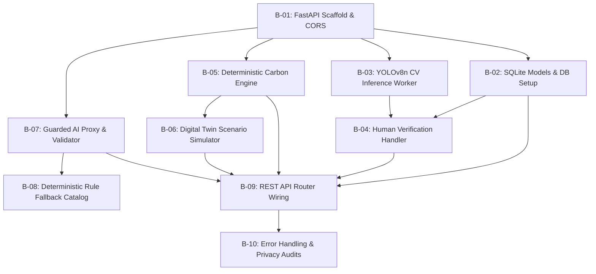

# Backend Engineering & Task Specification — TraceTwin

**Document Type:** Backend Technical Specification & Workstream Roadmap  
**Target Roles:** Backend Engineers, ML Engineers, Integration Owners (Workstream D, B, A)  
**Current Stage:** `Proposed` (For Live Implementation During Hackathon)  
**Last Updated:** October 15, 2026  
**Compliance Standard:** All code to be authored during the active 48-hour event; no pre-built starter templates.

---

## 1. Backend Mission & Architectural Objectives

The backend of **TraceTwin** acts as the central computational, data governance, and integration hub for the local single-laptop deployment.

### Core Objectives:
1. **Deterministic Authority:** The backend owns 100% of numerical calculations. All baseline emissions and scenario projections are calculated via strictly typed, side-effect-free Python functions. The AI model is strictly prohibited from computing or altering numerical figures.
2. **Local CPU Inference Efficiency:** Host and execute Ultralytics YOLOv8 Nano (`yolov8n.pt`) on local CPU with sub-3.5-second inference latency on standard $1920 \times 1080$ images without GPU dependencies.
3. **Strict Data Minimization & Privacy:** Enforce zero storage of Personally Identifiable Information (no student names, IDs, exact residential addresses, or raw attendance tables) in the local SQLite database.
4. **Resilient AI Guardrails with Automatic Fallback:** Wrap external Generative AI API calls in a strict schema validator with a hard 4,000 ms timeout. Automatically serve deterministic, rule-based recommendations labeled `"Rule-based plan (AI unavailable)"` upon any API timeout, network drop, or schema failure.
5. **Contract Governance:** Serve as the source of truth for the shared REST API contract, providing automated interactive OpenAPI documentation at `/docs`.

---

## 2. Technology Stack & Proposed Layout

### 2.1 Proposed Technology Choices
- **Runtime:** Python 3.11.x (standard 64-bit Windows installation).
- **Web Framework:** FastAPI (asynchronous route handlers, automated Pydantic schema validation).
- **ASGI Server:** Uvicorn with single worker process (`uvicorn main:app --reload --port 8000`).
- **Computer Vision:** Ultralytics YOLOv8 (`ultralytics` package running `yolov8n.pt` on PyTorch CPU).
- **Data Persistence:** SQLite3 via standard library `sqlite3` or SQLAlchemy ORM (`tracetwin.db`).
- **Data Validation:** Pydantic v2 models for all request bodies and response serialization.
- **External HTTP Client:** `httpx` or `urllib` for asynchronous LLM API calls with timeout controls.

### 2.2 Proposed Live Project Layout (To be created during event)
```text
backend/
├── main.py                 # FastAPI application factory, CORS, static mounts, startup events
├── config.py               # Environment variables, file paths, model weights configuration
├── database.py             # SQLite connection, session factory, table initialization
├── models.py               # Database table schemas / ORM models
├── schemas.py              # Pydantic request and response schemas (API contract)
├── cv_worker.py            # YOLOv8n loader, image validator, category mapper, box serializer
├── carbon_engine.py        # Pure Python deterministic VKT and tailpipe CO2 calculation formulas
├── scenario_engine.py      # Digital Twin scenario logic (remote days, carpool detour, shuttle fuel)
├── ai_guard.py             # LLM prompt builder, non-PII sanitizer, timeout gate, schema validator
├── fallback_catalog.py     # Deterministic rule-based recommendation catalog & trigger engine
└── routers/
    ├── assessments.py      # /api/assessments CRUD
    ├── vision.py           # /api/assessments/{id}/images and verification routes
    ├── commute.py          # /api/assessments/{id}/commute-inputs and baseline calculations
    └── scenarios.py        # /api/assessments/{id}/simulate scenario routes
```

---

## 3. Detailed Backend Task Breakdown

The backend development roadmap is organized into 10 structured engineering tasks:



### Task B-01: Application Scaffolding & Server Setup
- **Goal:** Initialize FastAPI application with CORS middleware, static file serving, and health-check endpoint.
- **Requirements:**
  - Configure `CORSMiddleware` to permit local browser access (`allow_origins=["*"]`).
  - Implement `GET /health` endpoint returning `{"status": "healthy", "cv_model_loaded": true}`.
  - Configure static file mount pointing to the frontend directory (`/`) for seamless single-origin execution.
  - Add startup event to verify writable volatile upload directory (`/tmp/uploads` or `./uploads`).

### Task B-02: SQLite Database Models & Session Management
- **Goal:** Create persistent relational tables enforcing data integrity and privacy rules.
- **Tables to Implement:**
  - `assessments` (`assessment_id`, `name`, `campus_area`, `reporting_period`, `annual_days`, `created_at`).
  - `parking_observations` (`observation_id`, `assessment_id`, `image_path`, `verified_cars`, `verified_motorcycles`, `verified_buses`, `verified_other`, `verification_status`).
  - `commute_inputs` (`input_id`, `assessment_id`, `category`, `daily_vehicles`, `avg_one_way_km`, `occupancy`, `sample_size`, `source_stream`).
  - `emission_factors` (`factor_id`, `category`, `value_kg_co2_per_vkt`, `source_title`, `geography`).
  - `scenario_runs` (`run_id`, `assessment_id`, `scenario_type`, `baseline_co2`, `scenario_co2`, `net_savings_co2`, `ai_recommendation_json`, `fallback_activated`).
- **Privacy Enforcement:** Zero columns for student names, registration numbers, or individual street addresses.

### Task B-03: Computer Vision Inference Worker (YOLOv8n CPU)
- **Goal:** Load pretrained YOLOv8n model and process uploaded parking images into normalized bounding boxes.
- **Requirements:**
  - Load `yolov8n.pt` into memory on application startup.
  - Input validation: Verify MIME type (`image/jpeg`, `image/png`), check file size ($\le 10\text{ MB}$).
  - Filter raw COCO detections to TraceTwin categories:
    - COCO `car` (class 2) $\rightarrow$ **Cars**
    - COCO `motorcycle` (class 3) $\rightarrow$ **Motorcycles and scooters**
    - COCO `bus` (class 5) $\rightarrow$ **Buses and campus shuttles**
    - COCO `truck` (class 7) $\rightarrow$ **Other fuel-burning vehicles**
  - Extract normalized bounding box coordinates $[x_{\min}, y_{\min}, x_{\max}, y_{\max}]$ and confidence score.
  - Suppress detections with confidence $< 0.35$.
  - Output summary count dictionary along with detection list.

### Task B-04: Human Verification & Snapshot Lock Handler
- **Goal:** Endpoint to receive human-reviewed detection counts and update persistent database state.
- **Endpoint:** `POST /api/assessments/{id}/verify`
- **Requirements:**
  - Ingest `image_id` and verified category counts (`verified_counts`).
  - Update `parking_observations` row: set `verification_status = 'Confirmed'`, set timestamp and reviewer notes.
  - Return confirmation payload tagged with `[Human-confirmed observation]`.

### Task B-05: Deterministic Carbon Engine Module
- **Goal:** Pure Python mathematical module computing annual vehicle-kilometres and tailpipe $CO_2$ emissions.
- **Formulas:**
  $$\text{VKT}_k = N_k \times D_k \times 2 \times Y$$
  $$\text{Emissions}_k (\text{kg } CO_2) = \text{VKT}_k \times EF_k$$
  $$\text{Total Baseline } (t CO_2) = \frac{\sum_k \text{Emissions}_k}{1000}$$
- **Factor Constants:**
  - Cars: $0.145 \text{ kg } CO_2/\text{km}$
  - Motorcycles & Scooters: $0.035 \text{ kg } CO_2/\text{km}$
  - Buses & Campus Shuttles: $0.850 \text{ kg } CO_2/\text{km}$
  - Other (including Auto-rickshaws): $0.078 \text{ kg } CO_2/\text{km}$
- **Validation:** Raise `ValueError` if $N_k < 0$, $D_k \le 0$, or $Y < 1$.

### Task B-06: Digital Twin Scenario Calculation Engine
- **Goal:** Recalculate campus emissions under operational interventions with rebound penalties.
- **Scenarios:**
  1. **Fewer Commute Days:**
     $$Y_{\text{scenario}} = Y_{\text{baseline}} \times (1 - P_{\text{remote}})$$
     Recompute VKT and emissions across all categories.
  2. **Carpooling Incentive:**
     Shift $N_{\text{shift}} = N_{\text{car}} \times S_{\text{pool}}$ solo drivers to occupancy $O_{\text{pool}} = 2.5$.  
     Apply 10% detour penalty: $D_{\text{pool}} = D_{\text{car}} \times 1.10$.  
     Compute new car fleet VKT and avoided emissions.
  3. **Institutional Bus / Campus Shuttle Intervention:**
     Shift private commuters into shuttles.  
     **Mandatory Added Shuttle Diesel Calculation:**
     $$\text{VKT}_{\text{shuttle}} = R \times T_{\text{trips}} \times (D_{\text{shuttle}} \times 2) \times Y$$
     $$\text{Added Emissions}_{\text{shuttle}} = \text{VKT}_{\text{shuttle}} \times EF_{\text{shuttle}}$$
     $$\text{Net Avoided } (t CO_2) = \frac{\text{Avoided Private} - \text{Added Shuttle}}{1000}$$
     Allow negative net savings if added shuttle fuel exceeds avoided private emissions.

### Task B-07: Guarded AI Proxy & Schema Validator
- **Goal:** Intercept and sanitize LLM calls, enforcing strict JSON schema and isolating numerical authority.
- **Requirements:**
  - Format non-PII prompt containing only aggregate scenario metrics (Tonnes $CO_2$, mode percentages).
  - Explicit system prompt forbidding LLM from inventing numbers or altering calculations.
  - Set request timeout to 4,000 ms.
  - Parse returned text with Pydantic JSON schema requiring `rec_id`, `title`, `difficulty`, `qualitative_rationale`, and `action_steps`.
  - Validate that `rec_id` belongs to the approved institutional catalog (`REC_REMOTE_01`, `REC_POOL_01`, `REC_SHUTTLE_01`, etc.).
  - Attach deterministic net savings numbers from Task B-06 to each recommendation card before returning to UI.

### Task B-08: Deterministic Rule-Based Fallback Catalog
- **Goal:** Pre-authored policy engine that triggers when the AI API fails, times out, or returns invalid schema.
- **Rule Triggers:**
  - *Trigger 1 (Car emissions > 50% of total):* Trigger `REC_POOL_01` ("Designated Carpool Parking Priority", Difficulty: Low).
  - *Trigger 2 (Average commute distance > 14 km):* Trigger `REC_SHUTTLE_01` ("High-Density Feeder Corridor Shuttle", Difficulty: Medium).
  - *Trigger 3 (Active days $\ge 200$):* Trigger `REC_REMOTE_01` ("Compressed Academic Timetabling", Difficulty: Low).
- **Fallback Response:** Returns valid recommendation array with `fallback_flag: true` and label `"Rule-based plan (AI unavailable)"`.

### Task B-09: REST API Router Wiring
- **Goal:** Wire all submodules into the FastAPI router according to the Shared API Contract:
  - `POST /api/assessments` $\rightarrow$ Assessment setup
  - `POST /api/assessments/{id}/images` $\rightarrow$ Upload & YOLO inference
  - `POST /api/assessments/{id}/verify` $\rightarrow$ Human count confirmation
  - `POST /api/assessments/{id}/commute-inputs` $\rightarrow$ Commute ingestion & baseline run
  - `POST /api/assessments/{id}/simulate` $\rightarrow$ Digital Twin simulation & guarded AI plan
  - `GET /api/assessments/{id}/methodology` $\rightarrow$ Active factor citations and formulas

### Task B-10: Backend Error Handling, Logging & Privacy Audits
- **Goal:** Robust exception handling and privacy guarantees.
- **Requirements:**
  - Global FastAPI exception handler returning structured JSON errors (`{"error": true, "message": "..."}`).
  - Request logging without recording user IPs or file contents.
  - Session cleanup utility to purge volatile uploaded images upon assessment closure.

---

## 4. Shared REST API Contract Specification

### 4.1 `POST /api/assessments`
- **Request Body (JSON):**
  ```json
  {
    "assessment_name": "DSU Autumn Audit 2026",
    "campus_area": "North Gate Parking",
    "reporting_period": "Academic Year 2026-27",
    "annual_days": 200
  }
  ```
- **Response Body (JSON, HTTP 201):**
  ```json
  {
    "assessment_id": "ast_9823",
    "status": "created",
    "annual_days": 200,
    "created_at": "2026-10-15T10:00:00Z"
  }
  ```

### 4.2 `POST /api/assessments/{id}/images`
- **Payload:** `multipart/form-data` with parameter `file` (binary JPEG/PNG).
- **Response Body (JSON, HTTP 200):**
  ```json
  {
    "image_id": "img_01",
    "width": 1920,
    "height": 1080,
    "detections": [
      {
        "detection_id": "det_01",
        "category": "Cars",
        "confidence": 0.89,
        "box": {"x_min": 120, "y_min": 340, "x_max": 280, "y_max": 490}
      }
    ],
    "snapshot_summary": {
      "Cars": 1,
      "Motorcycles and scooters": 0,
      "Buses and campus shuttles": 0,
      "Other fuel-burning vehicles": 0
    }
  }
  ```

### 4.3 `POST /api/assessments/{id}/verify`
- **Request Body (JSON):**
  ```json
  {
    "image_id": "img_01",
    "verified_counts": {
      "Cars": 15,
      "Motorcycles and scooters": 42,
      "Buses and campus shuttles": 2,
      "Other fuel-burning vehicles": 6
    },
    "reviewer_notes": "Reclassified 2 three-wheelers from Truck to Other; removed 1 bicycle."
  }
  ```
- **Response Body (JSON, HTTP 200):**
  ```json
  {
    "status": "confirmed",
    "evidence_label": "Human-confirmed observation",
    "verified_counts": {
      "Cars": 15,
      "Motorcycles and scooters": 42,
      "Buses and campus shuttles": 2,
      "Other fuel-burning vehicles": 6
    }
  }
  ```

### 4.4 `POST /api/assessments/{id}/commute-inputs`
- **Request Body (JSON):**
  ```json
  {
    "sample_size": 18,
    "population_total": 4500,
    "mode_data": [
      {"category": "Cars", "daily_vehicles": 14, "avg_one_way_km": 15.2, "occupancy": 1.1},
      {"category": "Motorcycles and scooters", "daily_vehicles": 22, "avg_one_way_km": 11.5, "occupancy": 1.0},
      {"category": "Buses and campus shuttles", "daily_vehicles": 2, "avg_one_way_km": 18.0, "occupancy": 35.0},
      {"category": "Other fuel-burning vehicles", "daily_vehicles": 4, "avg_one_way_km": 8.0, "occupancy": 1.8}
    ]
  }
  ```
- **Response Body (JSON, HTTP 200):**
  ```json
  {
    "assessment_id": "ast_9823",
    "sample_size": 18,
    "is_campus_projection": false,
    "total_annual_vkt": 218400.0,
    "total_annual_tonnes_co2": 24.62,
    "evidence_label": "Derived calculation",
    "category_breakdown": [
      {"category": "Cars", "daily_vehicles": 14, "annual_vkt": 85120.0, "emission_factor": 0.145, "annual_tonnes_co2": 12.34},
      {"category": "Motorcycles and scooters", "daily_vehicles": 22, "annual_vkt": 101200.0, "emission_factor": 0.035, "annual_tonnes_co2": 3.54},
      {"category": "Buses and campus shuttles", "daily_vehicles": 2, "annual_vkt": 14400.0, "emission_factor": 0.850, "annual_tonnes_co2": 12.24},
      {"category": "Other fuel-burning vehicles", "daily_vehicles": 4, "annual_vkt": 17680.0, "emission_factor": 0.078, "annual_tonnes_co2": 1.38}
    ]
  }
  ```

### 4.5 `POST /api/assessments/{id}/simulate`
- **Request Body (JSON):**
  ```json
  {
    "remote_days_percentage": 0.20,
    "carpool_shift_percentage": 0.30,
    "shuttle_routes": 2,
    "shuttle_trips_per_day": 4,
    "shuttle_one_way_km": 15.0
  }
  ```
- **Response Body (JSON, HTTP 200):**
  ```json
  {
    "baseline_tonnes_co2": 24.62,
    "scenario_tonnes_co2": 17.80,
    "avoided_private_tonnes_co2": 10.90,
    "added_shuttle_tonnes_co2": 4.08,
    "net_savings_tonnes_co2": 6.82,
    "fallback_activated": false,
    "recommendations": [
      {
        "rec_id": "REC_POOL_01",
        "title": "Designated Carpool Parking Priority",
        "difficulty": "Low",
        "qualitative_rationale": "Single-occupancy cars represent the largest emissions share. Providing reserved parking for verified carpools provides an immediate, low-cost mode shift incentive.",
        "attached_savings_tonnes": 4.12,
        "action_steps": [
          "Designate 15 stalls near the main academic entrance for carpools.",
          "Implement a digital registration tag for verified two-passenger vehicles."
        ]
      }
    ]
  }
  ```

---

## 5. Backend Quality & Verification Checklist

Before declaring the backend ready for final demonstration:
- [ ] `uvicorn main:app` launches cleanly with 0 console warnings or deprecation errors.
- [ ] PyTorch CPU inference on `yolov8n.pt` completes in $< 3.5\text{ seconds}$ on a test image.
- [ ] Hand-calculated benchmark cases (Benchmark 1: $45.000\text{ t } CO_2$; Benchmark 2: $38.480\text{ t } CO_2$) match the calculation engine output to 3 decimal places.
- [ ] Input validator rejects negative distances, negative vehicle counts, and invalid file types with HTTP 422/400.
- [ ] Shuttle scenario accurately computes added diesel fuel emissions and returns negative net savings if shuttle emissions exceed avoided car emissions.
- [ ] Guarded AI proxy strictly strips unapproved numbers and falls back to the deterministic catalog within 4,000 ms if network connection is severed.
- [ ] Database contains zero columns for student names, registration numbers, or individual street addresses.
