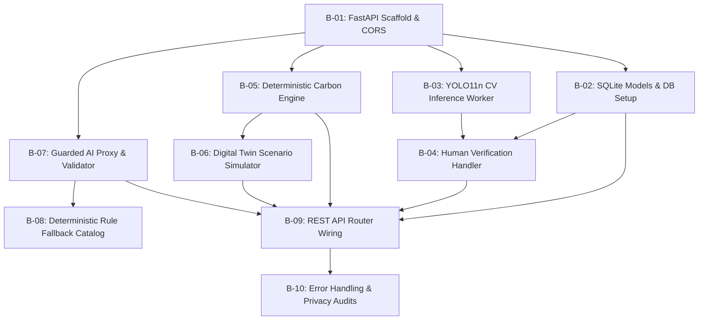

# Backend Engineering & Task Specification — TraceTwin

**Document Type:** Backend Technical Specification & Workstream Roadmap  
**Target Roles:** Backend Engineers, ML Engineers, Integration Owners (Workstream D, B, A)  
**Current Stage:** B3 governance plus illustrative judges-demo backend implemented; real model setup remains external
**Last Updated:** October 16, 2026
**Compliance Standard:** All code to be authored during the active 48-hour event; no pre-built starter templates.

> The compliance statement above records the original event plan. Current repository contents and verified work are tracked in `STATUS.md`; external event-rule applicability is not verified here.

---

## 1. Backend Mission & Architectural Objectives

The backend of **TraceTwin** acts as the central computational, data governance, and integration hub for the local single-laptop deployment.

### Core Objectives:
1. **Deterministic Authority:** The backend owns 100% of numerical calculations. All baseline emissions and scenario projections are calculated via strictly typed, side-effect-free Python functions. The AI model is strictly prohibited from computing or altering numerical figures.
2. **Local CPU Inference Efficiency:** Host and execute Ultralytics YOLO11 Nano (`yolo11n.pt`) on local CPU with sub-3.5-second inference latency on standard $1920 \times 1080$ images without GPU dependencies.
3. **Strict Data Minimization & Privacy:** Enforce zero storage of Personally Identifiable Information (no student names, IDs, exact residential addresses, or raw attendance tables) in the local SQLite database.
4. **Resilient AI Guardrails with Automatic Fallback:** Wrap external Generative AI API calls in a strict schema validator with a hard 4,000 ms timeout. Automatically serve deterministic, rule-based recommendations labeled `"Rule-based plan (AI unavailable)"` upon any API timeout, network drop, or schema failure.
5. **Contract Governance:** Serve as the source of truth for the shared REST API contract, providing automated interactive OpenAPI documentation at `/docs`.

---

## 2. Technology Stack & Proposed Layout

### 2.1 Proposed Technology Choices
- **Runtime:** Python 3.11.x (standard 64-bit Windows installation).
- **Web Framework:** FastAPI (asynchronous route handlers, automated Pydantic schema validation).
- **ASGI Server:** Uvicorn with single worker process (`uvicorn main:app --reload --port 8000`).
- **Computer Vision:** Ultralytics YOLO11 (`ultralytics` package running `yolo11n.pt` on PyTorch CPU) and OpenCV (`cv2`) for annotated image generation and image I/O.
- **Data Persistence:** SQLite3 via standard library `sqlite3` or SQLAlchemy ORM (`tracetwin.db`).
- **Data Validation:** Pydantic v2 models for all request bodies and response serialization.
- **External HTTP Client:** `httpx` or `urllib` for asynchronous LLM API calls with timeout controls.

### 2.2 Proposed Live Project Layout (To be created during event)
```text
backend/
├── main.py                 # FastAPI application factory, CORS, static mounts, startup events
├── config.py               # Environment variables, file paths, model weights configuration
├── database.py             # SQLite connection, session factory, table initialization
├── models.py               # Database table schemas / ORM models
├── schemas.py              # Pydantic request and response schemas (API contract)
├── cv_worker.py            # YOLO11n loader, image validator, category mapper, box serializer, OpenCV annotator
├── carbon_engine.py        # Pure Python deterministic VKT and tailpipe CO2 calculation formulas
├── scenario_engine.py      # Digital Twin scenario logic (remote days, carpool detour, shuttle fuel)
├── ai_guard.py             # LLM prompt builder, non-PII sanitizer, timeout gate, schema validator
├── fallback_catalog.py     # Deterministic rule-based recommendation catalog & trigger engine
└── routers/
    ├── assessments.py      # /api/assessments CRUD
    ├── vision.py           # /api/assessments/{id}/images and verification routes
    ├── commute.py          # /api/assessments/{id}/commute-inputs and baseline calculations
    └── scenarios.py        # /api/assessments/{id}/simulate scenario routes
```

---

## 3. Detailed Backend Task Breakdown

> The task breakdown below is the historical product roadmap. Some of its route, storage, and AI details are proposals rather than the current code. The implemented judges' demo endpoints, input contract, persistence, assumptions, and limits are specified in Section 7. In particular, the old automatic-weight-download instruction is not current behavior: weights must be supplied locally.

The backend development roadmap is organized into 10 structured engineering tasks:



### Task B-01: Application Scaffolding & Server Setup
- **Goal:** Initialize FastAPI application with CORS middleware, static file serving, and health-check endpoint.
- **Requirements:**
  - Configure `CORSMiddleware` for explicitly configured local browser origins; see the current contract in Section 6.
  - Implement `GET /health` returning only `{"status": "healthy"}` until optional services are actually loaded and measured.
  - Configure static file mount pointing to the frontend directory (`/`) for seamless single-origin execution.
  - Add startup event to verify writable volatile upload directory (`/tmp/uploads` or `./uploads`).

### Task B-02: SQLite Database Models & Session Management
- **Goal:** Create persistent relational tables enforcing data integrity and privacy rules.
- **B2 implementation boundary:** The current implementation creates only `assessments` and `commute_calculations` as described in Section 6. The other tables listed below remain proposed and are not created by B2.
- **Tables to Implement:**
  - `assessments` (`assessment_id`, `name`, `campus_area`, `reporting_period`, `annual_days`, `created_at`).
  - `parking_observations` (`observation_id`, `assessment_id`, `image_path`, `verified_cars`, `verified_motorcycles`, `verified_buses`, `verified_other`, `verification_status`).
  - `commute_inputs` (`input_id`, `assessment_id`, `category`, `daily_vehicles`, `avg_one_way_km`, `occupancy`, `sample_size`, `source_stream`).
  - `emission_factors` (`factor_id`, `category`, `value_kg_co2_per_vkt`, `source_title`, `geography`).
  - `scenario_runs` (`run_id`, `assessment_id`, `scenario_type`, `baseline_co2`, `scenario_co2`, `net_savings_co2`, `ai_recommendation_json`, `fallback_activated`).
- **Privacy Enforcement:** Zero columns for student names, registration numbers, or individual street addresses.

### Task B-03: Computer Vision Inference Worker (YOLO11n CPU & OpenCV Pipeline)
- **Goal:** Load pretrained Ultralytics YOLO11 Nano model (`yolo11n.pt`) and process uploaded parking images into normalized bounding boxes, category summaries, and annotated visualization images.
- **Technical Pipeline:**
  ```python
  # Core execution pattern
  from ultralytics import YOLO
  import cv2

  model = YOLO("yolo11n.pt")  # Downloads automatically on first run
  results = model.predict(source=image_path, conf=0.35, verbose=False)
  ```
- **Requirements:**
  - Load `yolo11n.pt` into memory on application startup.
  - Input validation: Verify MIME type (`image/jpeg`, `image/png`), check file size ($\le 10\text{ MB}$).
  - Supported COCO vehicle class mappings:
    - `1`: `Bicycle` $\rightarrow$ Detected and logged in vehicle report; rendered on canvas as an active transport observation (excluded from fuel-burning tailpipe carbon emissions calculation).
    - `2`: `Car` $\rightarrow$ Mapped to **Cars**.
    - `3`: `Motorcycle` $\rightarrow$ Mapped to **Motorcycles and scooters**.
    - `5`: `Bus` $\rightarrow$ Mapped to **Buses and campus shuttles**.
    - `7`: `Truck` $\rightarrow$ Mapped to **Other fuel-burning vehicles, including auto-rickshaws** (manual canvas reclassification supported).
  - Extract normalized bounding box coordinates $[x_{\min}, y_{\min}, x_{\max}, y_{\max}]$ and confidence score for interactive canvas rendering.
  - Generate annotated plot via `annotated_image = results[0].plot()` and save locally via `cv2.imwrite("detected_vehicles.jpg", annotated_image)` for immediate visualization.
  - Format summary count dictionary matching the CARBOSYNC report format:
    `{"Bicycle": count, "Car": count, "Motorcycle": count, "Bus": count, "Truck": count, "Total": total}`.

### Task B-04: Human Verification & Snapshot Lock Handler
- **Goal:** Endpoint to receive human-reviewed detection counts and update persistent database state.
- **Endpoint:** `POST /api/assessments/{id}/verify`
- **Requirements:**
  - Ingest `image_id` and verified category counts (`verified_counts`).
  - Update `parking_observations` row: set `verification_status = 'Confirmed'`, set timestamp and reviewer notes.
  - Return confirmation payload tagged with `[Human-confirmed observation]`.

### Task B-05: Deterministic Carbon Engine Module
- **Goal:** Pure Python mathematical module computing annual vehicle-kilometres and tailpipe $CO_2$ emissions.
- **Formulas:**
  $$\text{VKT}_k = N_k \times D_k \times 2 \times Y$$
  $$\text{Emissions}_k (\text{kg } CO_2) = \text{VKT}_k \times EF_k$$
  $$\text{Total Baseline } (t CO_2) = \frac{\sum_k \text{Emissions}_k}{1000}$$
- **Candidate factors (unverified; not implementation defaults):**
  - Cars: $0.145 \text{ kg } CO_2/\text{veh-km}$
  - Motorcycles & Scooters: $0.035 \text{ kg } CO_2/\text{veh-km}$
  - Buses & Campus Shuttles: $0.850 \text{ kg } CO_2/\text{veh-km}$
  - Other (including Auto-rickshaws): $0.078 \text{ kg } CO_2/\text{veh-km}$

These values are candidates copied from the planning register, not verified production factors. The API requires each caller to provide an explicit factor and its provenance; it does not select these values by default. Test fixtures such as `0.150` are for arithmetic checks only.
- **Validation:** Raise `ValueError` if $N_k < 0$, $D_k \le 0$, or $Y < 1$.

### Task B-06: Digital Twin Scenario Calculation Engine
- **Goal:** Recalculate campus emissions under operational interventions with rebound penalties.
- **Scenarios:**
  1. **Fewer Commute Days:**
     $$Y_{\text{scenario}} = Y_{\text{baseline}} \times (1 - P_{\text{remote}})$$
     Recompute VKT and emissions across all categories.
  2. **Carpooling Incentive:**
     Shift $N_{\text{shift}} = N_{\text{car}} \times S_{\text{pool}}$ solo drivers to occupancy $O_{\text{pool}} = 2.5$.  
     Apply 10% detour penalty: $D_{\text{pool}} = D_{\text{car}} \times 1.10$.  
     Compute new car fleet VKT and avoided emissions.
  3. **Institutional Bus / Campus Shuttle Intervention:**
     Shift private commuters into shuttles.  
     **Mandatory Added Shuttle Diesel Calculation:**
     $$\text{VKT}_{\text{shuttle}} = R \times T_{\text{trips}} \times (D_{\text{shuttle}} \times 2) \times Y$$
     $$\text{Added Emissions}_{\text{shuttle}} = \text{VKT}_{\text{shuttle}} \times EF_{\text{shuttle}}$$
     $$\text{Net Avoided } (t CO_2) = \frac{\text{Avoided Private} - \text{Added Shuttle}}{1000}$$
     Allow negative net savings if added shuttle fuel exceeds avoided private emissions.

### Task B-07: Guarded AI Proxy & Schema Validator
- **Goal:** Intercept and sanitize LLM calls, enforcing strict JSON schema and isolating numerical authority.
- **Requirements:**
  - Format non-PII prompt containing only aggregate scenario metrics (Tonnes $CO_2$, mode percentages).
  - Explicit system prompt forbidding LLM from inventing numbers or altering calculations.
  - Set request timeout to 4,000 ms.
  - Parse returned text with Pydantic JSON schema requiring `rec_id`, `title`, `difficulty`, `qualitative_rationale`, and `action_steps`.
  - Validate that `rec_id` belongs to the approved institutional catalog (`REC_REMOTE_01`, `REC_POOL_01`, `REC_SHUTTLE_01`, etc.).
  - Attach deterministic net savings numbers from Task B-06 to each recommendation card before returning to UI.

### Task B-08: Deterministic Rule-Based Fallback Catalog
- **Goal:** Pre-authored policy engine that triggers when the AI API fails, times out, or returns invalid schema.
- **Rule Triggers:**
  - *Trigger 1 (Car emissions > 50% of total):* Trigger `REC_POOL_01` ("Designated Carpool Parking Priority", Difficulty: Low).
  - *Trigger 2 (Average commute distance > 14 km):* Trigger `REC_SHUTTLE_01` ("High-Density Feeder Corridor Shuttle", Difficulty: Medium).
  - *Trigger 3 (Active days $\ge 200$):* Trigger `REC_REMOTE_01` ("Compressed Academic Timetabling", Difficulty: Low).
- **Fallback Response:** Returns valid recommendation array with `fallback_flag: true` and label `"Rule-based plan (AI unavailable)"`.

### Task B-09: REST API Router Wiring
- **Goal:** Wire all submodules into the FastAPI router according to the Shared API Contract:
  - `POST /api/assessments` $\rightarrow$ Assessment setup
  - `POST /api/assessments/{id}/images` $\rightarrow$ Upload & YOLO inference
  - `POST /api/assessments/{id}/verify` $\rightarrow$ Human count confirmation
  - `POST /api/assessments/{id}/commute-inputs` $\rightarrow$ Commute ingestion & baseline run
  - `POST /api/assessments/{id}/simulate` $\rightarrow$ Digital Twin simulation & guarded AI plan
  - `GET /api/assessments/{id}/methodology` $\rightarrow$ Active factor citations and formulas

### Task B-10: Backend Error Handling, Logging & Privacy Audits
- **Goal:** Robust exception handling and privacy guarantees.
- **Requirements:**
  - Global FastAPI exception handler returning structured JSON errors (`{"error": true, "message": "..."}`).
  - Request logging without recording user IPs or file contents.
  - Session cleanup utility to purge volatile uploaded images upon assessment closure.

---

## 4. Shared REST API Contract Specification

> **Status:** The examples in Sections 4.1–4.5 are historical proposed designs, not the current API contract. Sections 6 and 7 describe the implemented backend and are authoritative.

### 4.1 `POST /api/assessments`
- **Request Body (JSON):**
  ```json
  {
    "assessment_name": "DSU Autumn Audit 2026",
    "campus_area": "North Gate Parking",
    "reporting_period": "Academic Year 2026-27",
    "annual_days": 200
  }
  ```
- **Response Body (JSON, HTTP 201):**
  ```json
  {
    "assessment_id": "ast_9823",
    "status": "created",
    "annual_days": 200,
    "created_at": "2026-10-15T10:00:00Z"
  }
  ```

### 4.2 `POST /api/assessments/{id}/images`
- **Payload:** `multipart/form-data` with parameter `file` (binary JPEG/PNG).
- **Response Body (JSON, HTTP 200):**
  ```json
  {
    "image_id": "img_01",
    "width": 1920,
    "height": 1080,
    "detections": [
      {
        "detection_id": "det_01",
        "category": "Cars",
        "confidence": 0.89,
        "box": {"x_min": 120, "y_min": 340, "x_max": 280, "y_max": 490}
      }
    ],
    "snapshot_summary": {
      "Cars": 1,
      "Motorcycles and scooters": 0,
      "Buses and campus shuttles": 0,
      "Other fuel-burning vehicles": 0
    }
  }
  ```

### 4.3 `POST /api/assessments/{id}/verify`
- **Request Body (JSON):**
  ```json
  {
    "image_id": "img_01",
    "verified_counts": {
      "Cars": 15,
      "Motorcycles and scooters": 42,
      "Buses and campus shuttles": 2,
      "Other fuel-burning vehicles": 6
    },
    "reviewer_notes": "Reclassified 2 three-wheelers from Truck to Other; removed 1 bicycle."
  }
  ```
- **Response Body (JSON, HTTP 200):**
  ```json
  {
    "status": "confirmed",
    "evidence_label": "Human-confirmed observation",
    "verified_counts": {
      "Cars": 15,
      "Motorcycles and scooters": 42,
      "Buses and campus shuttles": 2,
      "Other fuel-burning vehicles": 6
    }
  }
  ```

### 4.4 `POST /api/assessments/{id}/commute-inputs`
- **Request Body (JSON):**
  ```json
  {
    "sample_size": 18,
    "population_total": 4500,
    "mode_data": [
      {"category": "Cars", "daily_vehicles": 14, "avg_one_way_km": 15.2, "occupancy": 1.1},
      {"category": "Motorcycles and scooters", "daily_vehicles": 22, "avg_one_way_km": 11.5, "occupancy": 1.0},
      {"category": "Buses and campus shuttles", "daily_vehicles": 2, "avg_one_way_km": 18.0, "occupancy": 35.0},
      {"category": "Other fuel-burning vehicles", "daily_vehicles": 4, "avg_one_way_km": 8.0, "occupancy": 1.8}
    ]
  }
  ```
- **Response Body (JSON, HTTP 200):**
  ```json
  {
    "assessment_id": "ast_9823",
    "sample_size": 18,
    "is_campus_projection": false,
    "total_annual_vkt": 218400.0,
    "total_annual_tonnes_co2": 24.62,
    "evidence_label": "Derived calculation",
    "category_breakdown": [
      {"category": "Cars", "daily_vehicles": 14, "annual_vkt": 85120.0, "emission_factor": 0.145, "annual_tonnes_co2": 12.34},
      {"category": "Motorcycles and scooters", "daily_vehicles": 22, "annual_vkt": 101200.0, "emission_factor": 0.035, "annual_tonnes_co2": 3.54},
      {"category": "Buses and campus shuttles", "daily_vehicles": 2, "annual_vkt": 14400.0, "emission_factor": 0.850, "annual_tonnes_co2": 12.24},
      {"category": "Other fuel-burning vehicles", "daily_vehicles": 4, "annual_vkt": 17680.0, "emission_factor": 0.078, "annual_tonnes_co2": 1.38}
    ]
  }
  ```

### 4.5 `POST /api/assessments/{id}/simulate`
- **Request Body (JSON):**
  ```json
  {
    "remote_days_percentage": 0.20,
    "carpool_shift_percentage": 0.30,
    "shuttle_routes": 2,
    "shuttle_trips_per_day": 4,
    "shuttle_one_way_km": 15.0
  }
  ```
- **Response Body (JSON, HTTP 200):**
  ```json
  {
    "baseline_tonnes_co2": 24.62,
    "scenario_tonnes_co2": 17.80,
    "avoided_private_tonnes_co2": 10.90,
    "added_shuttle_tonnes_co2": 4.08,
    "net_savings_tonnes_co2": 6.82,
    "fallback_activated": false,
    "recommendations": [
      {
        "rec_id": "REC_POOL_01",
        "title": "Designated Carpool Parking Priority",
        "difficulty": "Low",
        "qualitative_rationale": "Single-occupancy cars represent the largest emissions share. Providing reserved parking for verified carpools provides an immediate, low-cost mode shift incentive.",
        "attached_savings_tonnes": 4.12,
        "action_steps": [
          "Designate 15 stalls near the main academic entrance for carpools.",
          "Implement a digital registration tag for verified two-passenger vehicles."
        ]
      }
    ]
  }
  ```

---

## 5. Backend Quality & Verification Checklist

Before declaring the backend ready for final demonstration:
- [ ] `uvicorn main:app` launches cleanly with 0 console warnings or deprecation errors.
- [ ] PyTorch CPU inference on `yolo11n.pt` completes in $< 3.5\text{ seconds}$ on a test image.
- [ ] Hand-calculated benchmark cases (Benchmark 1: $45.000\text{ t } CO_2$; Benchmark 2: $38.480\text{ t } CO_2$) match the calculation engine output to 3 decimal places.
- [ ] Input validator rejects negative distances, negative vehicle counts, and invalid file types with HTTP 422/400.
- [ ] Shuttle scenario accurately computes added diesel fuel emissions and returns negative net savings if shuttle emissions exceed avoided car emissions.
- [ ] Guarded AI proxy strictly strips unapproved numbers and falls back to the deterministic catalog within 4,000 ms if network connection is severed.
- [ ] Database contains zero columns for student names, registration numbers, or individual street addresses.

---

## 6. Current API Contract and Implementation Status

This section supersedes earlier proposed schemas and examples in this document. It describes the implemented B3 API, not the full product roadmap.

### Implemented routes

#### `GET /health`

Returns HTTP `200` and `{"status":"healthy"}`. This reports that the API process responds; it does not claim a CV model is loaded.

#### `POST /api/assessments`

Accepts `{}` and returns HTTP `201` with a persisted server-generated `assessment_id` and UTC `created_at`. It collects no student-level personal information.

#### `GET /api/assessments/{assessment_id}`

Returns HTTP `200` with the assessment and saved calculations. An empty assessment has `commute_calculations: []`. Each calculation includes its IDs, timestamp, saved `inputs`, and saved `result`. Legacy B2 results are not rewritten; the response adds this metadata to their result:

```json
{"b3_metadata":{"availability":"unavailable_legacy_b2","activity_provenance":"unavailable","factor_governance":"unavailable","calculation_method_version":null}}
```

New B3 results contain `b3_metadata.availability: "available_b3"`. Unknown assessments return the safe `404` envelope.

SQLite uses `CARBOSYNC_DATABASE_PATH`, or repository-root `carbosync.db` when unset. Relative configured paths resolve from the process working directory. Connections are opened per operation, foreign keys are enabled, and the JSON input/result snapshots preserve calculation context.

#### `POST /api/assessments/{assessment_id}/commute-inputs`

This B3 contract intentionally replaces the B2 caller-supplied `emission_factor` field. Every request requires `calculation_mode` (`approved` or `candidate`), separate provenance for `annual_days`, `daily_vehicles`, and `avg_one_way_km`, and exactly one factor selection path for each category.

Example candidate request fragment (repeat one mode object for each of the four categories):

```json
{
  "calculation_mode": "candidate",
  "annual_days": 200,
  "annual_days_provenance": {
    "origin": "user_provided",
    "method": "Manual entry",
    "source_description": "Example input; not independently checked"
  },
  "sample_size": 18,
  "population_total": 4500,
  "mode_data": [{
    "category": "Cars",
    "daily_vehicles": 50,
    "daily_vehicles_provenance": {
      "origin": "estimated",
      "method": "Illustrative fixture",
      "source_description": "Test data only"
    },
    "avg_one_way_km": 15,
    "avg_one_way_km_provenance": {
      "origin": "user_provided",
      "method": "Manual entry",
      "source_description": "Example distance; not independently checked"
    },
    "occupancy": 1,
    "candidate_factor": {
      "factor_id": "EF_TEST_01",
      "version": "fixture-v1",
      "value": 0.150,
      "unit": "kg CO2/veh-km",
      "provenance": {
        "origin": "test_data",
        "factor_id": "EF_TEST_01",
        "metric_scope": "Tailpipe_CO2",
        "geographic_scope": "Not applicable (test fixture)",
        "source_title": "Test fixture",
        "source_url": null,
        "version_year": null,
        "approximation_notes": "Test-only; not an approved real-world factor"
      }
    }
  }]
}
```

Provenance origins are `observed`, `user_provided`, or `estimated`. Required text is trimmed and cannot be blank. `observed` requires a non-empty `observation_period`; other origins reject that field. `source_reference` is optional. This validates structure, not the truth of the description. A point-in-time parking observation does not establish daily arrivals or annual commuting.

In approved mode, each category uses `factor_reference: {"factor_id": ..., "version": ...}` only. The server resolves an immutable record from `backend/factor_registry.py`; caller-supplied values or metadata are forbidden. The approved registry is empty, so approved calculation requests currently return HTTP `503` with `{"error":true,"message":"Approved emission factors are currently unavailable."}`. No factor is inserted or approved by request data.

In candidate mode, each category uses `candidate_factor` and no `factor_reference`. Candidate factors accept only `user_supplied` or `test_data` provenance; `verified_reference` and approval overrides are rejected. The request's `version` is retained as a caller-declared label. The backend also derives an immutable `candidate-sha256:` snapshot version from the validated factor contents and category, so changed contents produce a different snapshot version. The backend labels results unapproved and does not modify the registry. `0.150` remains a test fixture; `0.145` remains unverified and neither is approved.

The response includes the existing totals and category breakdown plus `calculation_mode`, backend-assigned `approval_status`, `calculation_method_version: "commute_tailpipe_co2_v1"`, `metric_scope: "Tailpipe_CO2"`, `independently_verified: false`, and `b3_metadata`. New metadata uses `availability: "available_b3"`, `activity_provenance: "available"`, `factor_governance: "candidate_unapproved"` or `"approved_registry"`, and the method version. Each category includes its provenance and the factor snapshot used. Occupancy remains required but unused. `is_campus_projection` is always `false`; sample and population fields do not trigger extrapolation.

The method version specifies annual vehicle-kilometres = daily vehicles × one-way kilometres × 2 × annual days; annual kg CO₂ = vehicle-kilometres × factor in `kg CO2/veh-km`; tonnes = kg ÷ 1,000. It represents direct tailpipe CO₂ only. Fuel/powertrain is not requested, so matching on that dimension is not performed or claimed.

### Error responses

Handled errors use `{"error":true,"message":"..."}` and do not expose rejected values, exception details, or stack traces. Validation is `422`; unknown resources are `404`; an empty approved registry is `503`; unexpected exceptions are generic `500`. The approved-factor-unavailable response is described above. Other HTTP errors retain safe status-specific messages.

### CORS

`CARBOSYNC_CORS_ORIGINS` accepts comma-separated origins, trimming whitespace and ignoring empty entries. Defaults are `http://localhost:5500` and `http://127.0.0.1:5500`; there is no wildcard default. Credentials are disabled, methods are `GET`, `POST`, and `OPTIONS`, and headers are `Content-Type` and `Authorization`.

### Boundaries and planned work

Human review, frontend integration, environmental data, projections, and PDF export are not implemented. The B3 API does not convert parking images into daily traffic. Student-level personal data is not collected. No real-world factor is approved or independently authenticated by this implementation.

## 7. Judges' Demo API

This flow is separate from the B3 approved/candidate assessment API. It never inserts factors into or bypasses the empty approved registry. Every result is labelled illustrative_unapproved, not a verified campus inventory.

### POST /api/demo/analyze

Send multipart/form-data with image (JPEG, PNG, or WebP, at most 10 MiB and 40 megapixels) and assumptions_json (a JSON string). Every assumption and all four motor-category factors are required; the endpoint has no silent factor defaults.

Example assumptions_json form value:

    {
      "annual_operating_days": 200,
      "annual_days_source_description": "Illustrative assumption; replace for a real campus.",
      "vehicle_assumptions": {
        "bicycle": {"trips_per_vehicle_per_operating_day": 1, "avg_one_way_km": 4, "source_description": "Illustrative only."},
        "car": {"trips_per_vehicle_per_operating_day": 1, "avg_one_way_km": 12, "source_description": "Illustrative only."},
        "motorcycle": {"trips_per_vehicle_per_operating_day": 1, "avg_one_way_km": 10, "source_description": "Illustrative only."},
        "bus": {"trips_per_vehicle_per_operating_day": 2, "avg_one_way_km": 8, "source_description": "Illustrative only."},
        "truck": {"trips_per_vehicle_per_operating_day": 1, "avg_one_way_km": 8, "source_description": "Illustrative only."}
      },
      "illustrative_factors": {
        "car": {"factor_id": "DEMO_CAR", "vehicle_category": "car", "value": 0.15, "unit": "kg CO2/veh-km", "geographic_scope": "Illustrative only", "source_description": "Not sourced or approved.", "source_reference": null, "applicability_notes": "Car only; fuel not checked.", "limitations": "Illustrative only."},
        "motorcycle": {"factor_id": "DEMO_MOTORCYCLE", "vehicle_category": "motorcycle", "value": 0.04, "unit": "kg CO2/veh-km", "geographic_scope": "Illustrative only", "source_description": "Not sourced or approved.", "source_reference": null, "applicability_notes": "Motorcycle only; fuel not checked.", "limitations": "Illustrative only."},
        "bus": {"factor_id": "DEMO_BUS", "vehicle_category": "bus", "value": 0.8, "unit": "kg CO2/veh-km", "geographic_scope": "Illustrative only", "source_description": "Not sourced or approved.", "source_reference": null, "applicability_notes": "Bus only; fuel not checked.", "limitations": "Illustrative only."},
        "truck": {"factor_id": "DEMO_TRUCK", "vehicle_category": "truck", "value": 0.08, "unit": "kg CO2/veh-km", "geographic_scope": "Illustrative only", "source_description": "Not sourced or approved.", "source_reference": null, "applicability_notes": "Truck only; fuel not checked.", "limitations": "Illustrative only."}
      },
      "scenario_assumptions": {
        "carpool_activity_reduction_share": 0.2,
        "shuttle_shift_share": 0.15,
        "active_travel_shift_share": 0.1,
        "active_travel_max_one_way_km": 5,
        "assumption_basis": "Editable demonstration settings, not measured policy effects.",
        "shuttle_service": {"daily_vehicles": 1, "trips_per_vehicle_per_operating_day": 2, "avg_one_way_km": 8, "source_description": "Illustrative shuttle assumption."}
      }
    }

The request rejects missing categories/factors, unsupported units, non-finite or out-of-range values, mismatched factor categories, invalid shares, and blank assumption descriptions. Backend status is fixed to illustrative_unapproved. Caller-provided factor IDs and values are demo settings only and cannot confer approval.

COCO class IDs map to 1 bicycle, 2 car, 3 motorcycle, 5 bus, and 7 truck. Other classes are ignored. The response includes per-class counts, motor-vehicle and bicycle totals, model name, confidence threshold, and an annotated JPEG data URI. No filesystem path is returned. The upload is validated and closed; source and annotated images are not stored.

Validation checks MIME/content agreement, readability, a 10 MiB limit, and dimensions up to 40 megapixels. A request-body guard caps multipart overhead before file spooling. The model loads lazily once per process and is reused. Default local weights path: backend/models/yolo11n.pt. Override with CARBOSYNC_YOLO_MODEL_PATH. Weights are not included or automatically downloaded. Missing weights/runtime return safe HTTP 503. CARBOSYNC_YOLO_CONFIDENCE defaults to 0.35 and must be in (0, 1].

### Calculation and scenarios

A trip means one assumed campus commute cycle per detected vehicle per operating day; each cycle represents two one-way legs:

    annual vehicle-km = detected count × assumed commute cycles/day × one-way km × 2 × annual operating days
    annual kg CO2 = annual vehicle-km × illustrative factor in kg CO2/veh-km
    tonnes CO2 = kg CO2 / 1000

A single image is only a point-in-time count. Applying daily trips assumes each visible vehicle represents an active vehicle in the submitted activity assumptions; the image itself does not establish daily flow, unique vehicles, trip purpose, distance, fuel, occupancy, or annual patterns. No sample extrapolation occurs.

The three simulations reuse the same deterministic estimate service: carpool activity consolidation reduces a supplied share of car trips; shuttle shift removes a supplied share of car/motorcycle activity and adds a separately specified shuttle service; active travel reduces a supplied share of short car/motorcycle activity within the supplied distance limit. Scenarios return assumptions, results, changes and limitations. Negative reduction means emissions increase. The shuttle case is not a demand/capacity model. Walking and cycling have no motor-vehicle tailpipe emissions. Backend selects the best scenario.

### GET /api/demo/analyses/{analysis_id}

Returns persisted ID, UTC time, structured detection/model metadata, submitted assumptions/factors, baseline, scenarios, and recommendation status. Unknown IDs return safe 404. An additive SQLite demo_analyses table stores JSON snapshots only; images and secrets are not stored.

### Recommendations and configuration

Missing credentials, timeout, provider errors, or invalid output activate deterministic fallback recommendations with fallback_flag true and label “Rule-based plan (AI unavailable)”. Optional OpenAI-compatible Chat Completions configuration uses CARBOSYNC_LLM_PROVIDER=openai_compatible, CARBOSYNC_LLM_API_KEY, CARBOSYNC_LLM_BASE_URL, and CARBOSYNC_LLM_MODEL. Default model is gpt-4o-mini; timeout is four seconds. HTTPS is required except localhost. The provider receives structured metrics and assumptions, never the image. The backend supplies the computed best scenario and rejects numeric or citation claims in generated prose. Keys are never returned or persisted. Live provider behavior has not been verified without credentials.

### Local setup

Install requirements.txt into the project virtual environment. Provide an authorized YOLO11n weight file locally at backend/models/yolo11n.pt or set CARBOSYNC_YOLO_MODEL_PATH; installing packages does not download model weights. Set CARBOSYNC_DATABASE_PATH for a writable SQLite file and CARBOSYNC_CORS_ORIGINS for browser origins. Start using the project interpreter with uvicorn backend.main:app --reload, then inspect or call the endpoint at /docs.
