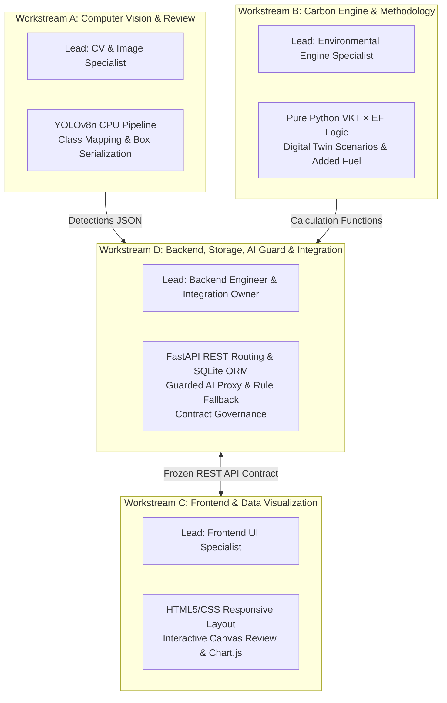
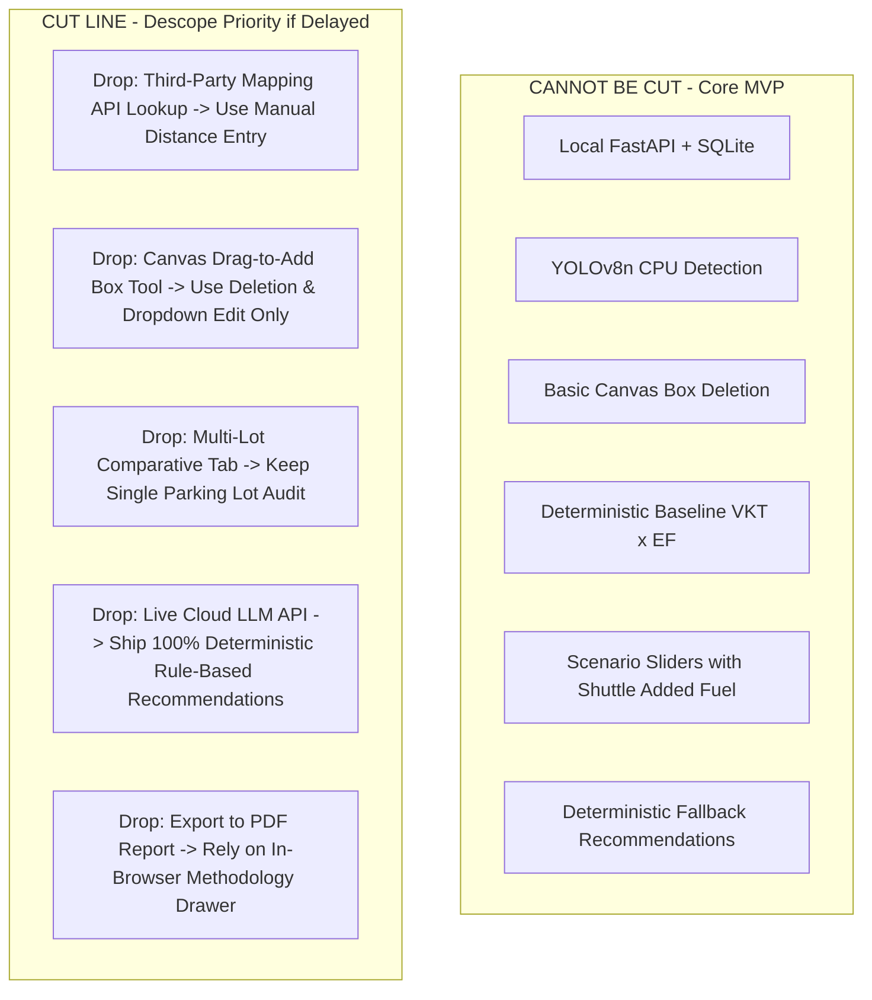

# 48-Hour Hackathon Execution & Delivery Roadmap — TraceTwin

**Document Type:** Hackathon Project Management & Workstream Roadmap  
**Event:** Dayananda Sagar University Code Clash 2.0 (October 15–16, 2026)  
**Execution Horizon:** 48 Hours  
**Current Stage:** Pre-Hackathon Planning & Role Allocation  

---

## 1. Execution Strategy & Guiding Principles

1. **Zero Pre-Built Code Compliance:** All code authoring begins strictly upon official competition kickoff.
2. **Vertical Slice Over Horizontal Layers:** Prioritize delivering a functional, end-to-end "walking skeleton" within the first 14 hours over isolated, unfinished deep features.
3. **Contract-First Collaboration:** Workstream development is decoupled via a frozen REST API contract, allowing frontend and backend to build concurrently using mock data.
4. **Dedicated Integration Leadership:** Workstream D acts as the designated **Integration Owner**, possessing ultimate authority over schema changes, merge approvals, and integration checkpoint verification.

---

## 2. Four Parallel Workstreams & Role Allocations

> [!NOTE]
> **Team Assignment Notice:** The team comprises four members with mostly beginner-to-intermediate capabilities. Team members will be formally assigned to these role profiles during Kickoff Hour 0 based on individual preferences. No fictional member names are invented in this plan.

### Workstream A: Computer Vision & Image Review Specialist
- **Core Focus:** Local image processing, Ultralytics YOLOv8n CPU pipeline, normalized bounding box extraction, and vehicle category remapping.
- **Key Deliverables:** Verified inference script, class remapping dictionary, test suite with 5 diverse parking photographs.

### Workstream B: Carbon Engine, Factors & Methodology Specialist
- **Core Focus:** Pure Python mathematical implementation of baseline formulas ($\text{VKT} \times EF$), Digital Twin scenario logic (detour penalties, added shuttle fuel), and factor register verification.
- **Key Deliverables:** Standalone calculation module, unit tests with hand-calculated benchmark cases, transparent methodology drawer copy.

### Workstream C: Frontend & Data Visualization Specialist
- **Core Focus:** User interface presentation, HTML5 Canvas bounding box editor, Chart.js mode-share breakdowns, dynamic scenario sliders, and evidence badge styling.
- **Key Deliverables:** Clean vanilla web application, interactive bounding box manipulation (delete, reclassify, add), responsive dashboard layout.

### Workstream D: Backend, Storage, AI Guard & Integration Owner
- **Core Focus:** FastAPI server scaffolding, SQLite database models, Pydantic request/response schemas, Guarded LLM proxy with 4-second timeout, deterministic fallback catalog, and end-to-end integration.
- **Key Deliverables:** Running local API server, automated OpenAPI docs (`/docs`), database persistence, deterministic fallback guarantee, live demo conductor.

---

## 3. The Shared API Contract (Contract-First Freeze)

By **Hour 3**, the team freezes the following API contracts to allow independent, parallel development:

| HTTP Method | Route Path | Mock Provider | Consumer | Target Freeze |
| :---: | :--- | :--- | :--- | :---: |
| `POST` | `/api/assessments` | Workstream D | Workstream C | Hour 3 |
| `POST` | `/api/assessments/{id}/images` | Workstream A / D | Workstream C | Hour 3 |
| `POST` | `/api/assessments/{id}/verify` | Workstream D | Workstream C | Hour 3 |
| `POST` | `/api/assessments/{id}/commute-inputs` | Workstream D | Workstream C | Hour 3 |
| `POST` | `/api/assessments/{id}/simulate` | Workstream B / D | Workstream C | Hour 3 |

---

## 4. 48-Hour Execution Timeline & Milestones

### Phase 0: Kickoff, Environment Setup & Feasibility (Hours 0 – 3)
- **H0.0 – H1.0:** Verify Python 3.11, PyTorch CPU, Ultralytics, and browser environment on the primary laptop. Initialize fresh Git repository.
- **H1.0 – H2.0:** Assign team members to Workstreams A, B, C, D. Run inference benchmark of `yolov8n.pt` on CPU to confirm latency $< 3.5\text{s}$.
- **H2.0 – H3.0:** Review and freeze the Shared REST API Contract. Workstream C begins building UI against mock JSON fixtures.

### Phase 1: Vertical Slice 1 — The Walking Skeleton (Hours 3 – 14)
- **H3.0 – H8.0:**
  - *Stream A:* Build minimal image ingestion script running YOLOv8n and outputting bounding box JSON.
  - *Stream B:* Write standalone Python function computing Benchmark Case 1 ($\text{VKT} \times EF = 45.0 \text{ t } CO_2$).
  - *Stream C:* Build basic HTML skeleton with image upload input and placeholder results table.
  - *Stream D:* Scaffold FastAPI server with CORS, upload handler, and mock simulation endpoint.
- **H8.0 – H14.0:** Wire the components together.  
  **Milestone 1 (Hour 14 Checkpoint):** *Upload an image $\rightarrow$ execute YOLO detection $\rightarrow$ display raw boxes on screen $\rightarrow$ calculate sample baseline emissions in backend.*

### Phase 2: Core Feature Engineering (Hours 14 – 28)
- **H14.0 – H20.0:**
  - *Stream A:* Implement category remapping (COCO to 4 categories) and auto-rickshaw heuristics.
  - *Stream B:* Implement three Digital Twin scenarios (Remote Days, Carpooling with 10% detour, Shuttle with added diesel fuel).
  - *Stream C:* Build interactive Canvas editor (click to delete box, dropdown to change class, drag to add box).
  - *Stream D:* Create SQLite schema (`assessments`, `parking_observations`, `commute_inputs`).
- **H20.0 – H28.0:**
  - *Stream C:* Integrate Chart.js bar/doughnut charts and dynamic scenario sliders.
  - *Stream D:* Implement Guarded AI Proxy with JSON schema interceptor and 4-second timeout.
  - *Stream B & D:* Build the deterministic rule-based fallback recommendation catalog.  
  **Milestone 2 (Hour 28 Checkpoint):** *Interactive bounding box review functional; scenario sliders update emissions dynamically; AI proxy successfully falls back to rule catalog when offline.*

### Phase 3: Integration & System Hardening (Hours 28 – 36)
- **H28.0 – H32.0:** Full subsystem integration. Connect Canvas verified counts to database; wire scenario sliders to live simulation endpoint.
- **H32.0 – H36.0:** Attach Evidence Labels (`[Direct observation]`, `[Human-confirmed observation]`, etc.) to every UI metric. Build Methodology Drawer modal with factor citations and sample size warnings.  
  **Milestone 3 (Hour 36 Checkpoint):** *Complete feature freeze. No new features permitted after Hour 36.*

### Phase 4: Testing & Edge-Case Verification (Hours 36 – 42)
- **H36.0 – H39.0:** Execute Master Test Plan ([TEST_PLAN.md](file:///c:/Users/yasha/OneDrive/Documents/Trace_Twin/TraceTwin_Documentation/TEST_PLAN.md)):
  - Run Benchmark Cases 1 & 2 (numerical verification).
  - Test negative input validation (negative distance, negative days).
  - Test shuttle low-occupancy negative net savings scenario.
  - Test AI timeout fallback by disconnecting laptop Wi-Fi.
- **H39.0 – H42.0:** Resolve critical UI bugs, CSS alignment glitches, and mobile/desktop viewport scaling.

### Phase 5: Demo Rehearsal, Polish & Submission (Hours 42 – 48)
- **H42.0 – H45.0:** Script and rehearse the 4-minute live demonstration. Assign speaking roles:
  - *Speaker 1:* Problem statement, traffic invisibility, and hackathon scope (1 min).
  - *Speaker 2:* Live demo: Parking photo upload $\rightarrow$ CV detection $\rightarrow$ Human verification loop (1 min).
  - *Speaker 3:* Live demo: Baseline emissions, Digital Twin scenarios (shuttle added emissions), and Guarded AI fallback test (1.5 min).
  - *Speaker 4:* Methodology transparency, factor provenance, and evaluator Q&A defense (0.5 min).
- **H45.0 – H47.0:** Package project submission: clean repository, final Git commit, README verification, submission portal upload.
- **H47.0 – H48.0:** Final laptop battery check, local offline cache verification, and standby for judges' evaluation.

---

## 5. Feature Cut Line (Emergency Scope Reduction Protocol)

If development falls behind schedule at the Hour 28 Checkpoint, the Integration Owner enforces the following cut line:

---

## 6. Definition of Done (DoD)

A feature or workstream is declared **Done** during the hackathon only when:
1. **Code Compiles & Runs Locally:** Executes without terminal warnings, unhandled promise rejections, or memory leaks on the primary laptop.
2. **API Contract Compliant:** Matches the exact request and response schemas specified in [DATA_DICTIONARY.md](file:///c:/Users/yasha/OneDrive/Documents/Trace_Twin/TraceTwin_Documentation/DATA_DICTIONARY.md).
3. **Unit / Verification Test Passed:** Passes its corresponding test case in [TEST_PLAN.md](file:///c:/Users/yasha/OneDrive/Documents/Trace_Twin/TraceTwin_Documentation/TEST_PLAN.md) with documented evidence.
4. **Evidence Label Attached:** Any newly introduced metric renders its correct evidence provenance tag on the UI.
5. **Approved by Integration Owner:** Reviewed and merged without breaking existing vertical slice flows.
