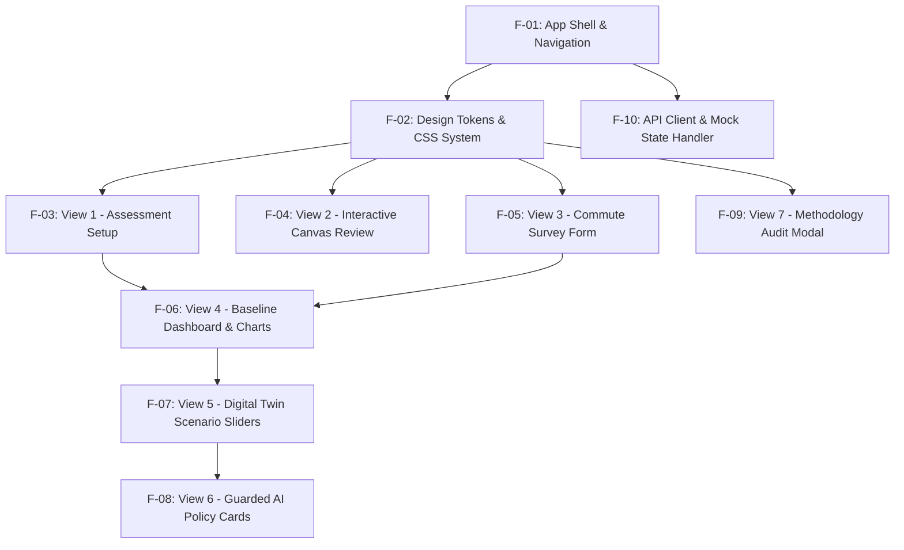

# Frontend Engineering & Task Specification — TraceTwin

**Document Type:** Frontend Technical Specification & Workstream Roadmap  
**Target Roles:** Frontend Developers, UI/UX Designers (Workstream C)  
**Current Stage:** `Proposed` (For Live Implementation During Hackathon)  
**Last Updated:** October 15, 2026  
**Compliance Standard:** All code to be authored during the active 48-hour event; no pre-built starter templates.

---

## 1. Frontend Mission & Design Objectives

The frontend of **TraceTwin** is responsible for delivering an intuitive, high-impact, and scientifically transparent user interface running locally on the evaluation laptop.

### Core Objectives:
1. **Zero-Build, High-Velocity Architecture:** Utilize native browser technologies (Vanilla HTML5, modern CSS3, ES6+ JavaScript) and local script tags (Chart.js) to guarantee instant reload, zero build-step failures, and seamless live debugging.
2. **Interactive Human-in-the-Loop Review:** Provide an interactive HTML5 Canvas / SVG overlay allowing users to inspect computer-vision bounding boxes, delete false positives, reclassify vehicles, and manually draw missing vehicles.
3. **Dynamic Digital Twin Simulation:** Implement responsive sliders and input controls that trigger real-time recalculations and dynamic chart updates without full page reloads.
4. **Evidence & Provenance Transparency:** Automatically render standardized evidence badges (`[Direct observation]`, `[Human-confirmed observation]`, `[Survey-reported value]`, `[Source-derived value]`, `[Assumption]`, `[Derived calculation]`) on every metric.
5. **Graceful Guarded AI & Fallback Presentation:** Render AI policy recommendation cards with deterministically attached numbers, displaying a clear `"Rule-based plan (AI unavailable)"` banner whenever the fallback is triggered.

---

## 2. Technology Stack & Directory Structure

### 2.1 Proposed Technology Choices
- **Markup:** Semantic HTML5 (`<header>`, `<nav>`, `<main>`, `<section>`, `<article>`, `<footer>`).
- **Styling:** Vanilla CSS3 with CSS Custom Properties (Design Tokens), Flexbox, CSS Grid, and custom Dark Mode Glassmorphism aesthetics.
- **Client Logic:** Native ES6+ JavaScript (Fetch API, Async/Await, Canvas API, DOM manipulation).
- **Visualization:** Chart.js (v4.x via local static JS file or CDN fallback) for bar, doughnut, and comparative charts.
- **Canvas Overlay:** HTML5 2D Context API for bounding-box manipulation.

### 2.2 Proposed Live Project Layout (To be created during event)
```text
frontend/
├── index.html              # Single-page shell with tabbed/modular view sections
├── css/
│   ├── main.css            # Global design tokens, typography, reset, layout
│   ├── components.css      # Cards, buttons, badges, evidence tags, modal styles
│   └── canvas.css          # Interactive canvas overlay and toolbar styling
└── js/
    ├── app.js              # Application coordinator & state store
    ├── api.js              # REST client wrapping fetch() with error handling
    ├── canvas_editor.js    # Interactive bounding box drawing, selection & deletion
    ├── charts.js           # Chart.js initialization & dynamic update functions
    ├── scenarios.js        # Digital Twin slider listeners & recalculation triggers
    └── mocks.js            # Standalone mock fixtures for offline frontend testing
```

---

## 3. Detailed Frontend Task Breakdown

The frontend development roadmap is broken into 10 structured tasks designed for beginner-to-intermediate execution:



### Task F-01: Application Shell & Tab Navigation
- **Goal:** Build the single-page layout structure containing a persistent top header, assessment status bar, tab navigation, and responsive content container.
- **Requirements:**
  - Header with project branding: `"TraceTwin: Campus Commute Emissions Intelligence"`.
  - Navigation tabs: `1. Assessment`, `2. Parking CV Audit`, `3. Commute Data`, `4. Baseline Emissions`, `5. Digital Twin Scenarios`, `6. Methodology & Audit`.
  - Offline/Online connectivity status indicator badge.
  - Active assessment metadata chip (e.g., `"Active Audit: DSU North Gate | 200 Days"`).

### Task F-02: Design Tokens & Component Styling
- **Goal:** Implement a cohesive, premium dark-mode theme utilizing CSS Custom Properties.
- **Color Palette (CSS Tokens):**
  - Background Base: `#0f172a` (Slate 900)
  - Card Surface: `rgba(30, 41, 59, 0.7)` (Translucent Slate 800 with `backdrop-filter: blur(12px)`)
  - Accent / Primary: `#38bdf8` (Sky Blue)
  - Success / Green: `#22c55e` (Emerald)
  - Warning / Amber: `#f59e0b` (Amber)
  - Danger / Negative Savings: `#ef4444` (Red)
  - Text Primary: `#f8fafc`, Text Muted: `#94a3b8`
- **Evidence Tag Component Styles:**
  - `[Direct observation]`: Blue badge (`#0284c7`)
  - `[Human-confirmed observation]`: Green badge (`#16a34a`)
  - `[Survey-reported value]`: Purple badge (`#9333ea`)
  - `[Source-derived value]`: Amber badge (`#d97706`)
  - `[Assumption]`: Gray badge (`#64748b`)
  - `[Derived calculation]`: Teal badge (`#0d9488`)

### Task F-03: View 1 — Assessment Setup Form
- **Goal:** Form allowing the user to initialize an emissions audit session.
- **Fields:**
  - Audit Name (`assessment_name`, text input).
  - Target Campus / Facility (`campus_area`, e.g., "North Gate Parking").
  - Reporting Period (`reporting_period`, dropdown: "Academic Year 2026-27", "Semester 1").
  - Annual Academic Days (`annual_days`, number input, default: 200, bounds: 1–366).
- **Behavior:** Submits `POST /api/assessments` and transitions user to the Parking Audit tab upon receipt of `assessment_id`.

### Task F-04: View 2 — Parking Image Upload & Interactive Canvas Review
- **Goal:** Provide an image upload interface and interactive canvas where users inspect and correct computer vision detections.
- **Requirements:**
  - Drag-and-drop or file picker for JPEG/PNG parking snapshot.
  - Progress spinner while backend runs YOLOv8n inference on CPU.
  - HTML5 Canvas rendering the uploaded image scaled to fit container.
  - Render color-coded bounding rectangles for detected vehicles:
    - Cars: Blue (`#38bdf8`)
    - Motorcycles & Scooters: Orange (`#f97316`)
    - Buses & Shuttles: Green (`#22c55e`)
    - Other (including Auto-rickshaws): Purple (`#a855f7`)
  - **User Interactions on Canvas:**
    - Click box $\rightarrow$ shows action popup with Delete button and Class dropdown.
    - Delete button $\rightarrow$ removes box from array; updates summary count chip.
    - Class dropdown $\rightarrow$ changes category (e.g., converts misidentified `truck` to `Other fuel-burning vehicles`).
    - Drag on empty canvas $\rightarrow$ draws a new box and opens category picker (`is_manually_added`).
  - "Confirm Verification" button $\rightarrow$ sends confirmed counts to backend (`POST /api/assessments/{id}/verify`) and marks state as `[Human-confirmed observation]`.

### Task F-05: View 3 — Commute Activity & Survey Data Entry
- **Goal:** Ingest modal commute parameters (counts, distances, occupancies).
- **Requirements:**
  - Data table with rows for the 4 core categories:
    1. Cars
    2. Motorcycles and scooters
    3. Buses and campus shuttles
    4. Other fuel-burning vehicles, including auto-rickshaws
  - Input columns: `Daily Vehicles (N)`, `Average One-Way Distance (km)`, `Vehicle Occupancy (persons/veh)`.
  - Survey sample size input (`sample_size`, integer).
  - **Small Sample Alert:** If `sample_size < 20`, prominently render an Amber alert:  
    `"⚠️ Sample Size: n = 18 (< 20). Headline metric restricted to Sample-Based Baseline."`
  - Quick-preset button: "Load DSU Sample Survey (n=18)" to instantly populate realistic demo values.

### Task F-06: View 4 — Baseline Emissions Dashboard & Charts
- **Goal:** Present the calculated baseline carbon footprint clearly with evidence transparency.
- **Requirements:**
  - Summary KPI Cards:
    - Total Annual Commute Emissions ($t CO_2/\text{year}$) with `[Derived calculation]` tag.
    - Total Annual Vehicle-Kilometres ($\text{VKT}$) with `[Derived calculation]` tag.
    - Survey Sample Size ($n$) with `[Survey-reported value]` tag.
    - Active Academic Days ($Y = 200$) with `[Source-derived value]` tag.
  - Mode Breakdown Chart (Chart.js Doughnut): Visualizing percentage contribution of Cars vs. Two-Wheelers vs. Buses vs. Auto-rickshaws.
  - Category Metrics Table: Columns for Category, Daily Vehicles, Annual VKT, Emission Factor ($\text{kg } CO_2/\text{km}$), and Total Tonnes $CO_2$.
  - Dual Baseline Mode Toggle:
    - Default: "Sample-Based Baseline" (evaluates surveyed vehicles only).
    - Optional Toggle: "Campus Projected Total" (renders explicit assumptions banner before scaling).

### Task F-07: View 5 — Digital Twin Scenario Simulation Panel
- **Goal:** Dynamic controls to test campus decarbonization policies and visualize counterfactual outcomes.
- **Requirements:**
  - **Scenario 1 Control:** Remote Learning / Hybrid Schedule Slider ($0\%\text{--}50\%$ reduction in on-campus days).
  - **Scenario 2 Control:** Carpool Mode Shift Slider ($0\%\text{--}60\%$ of solo car drivers shifted to 2.5-person carpools, with a 10% detour penalty).
  - **Scenario 3 Control:** Institutional Shuttle Simulator:
    - Number of Shuttle Routes ($1\text{--}5$).
    - Roundtrips per day ($2\text{--}10$).
    - One-way route distance (km).
  - **Comparison Visualizations:**
    - Chart.js Grouped Bar Chart comparing Baseline vs. Scenario 1 vs. Scenario 2 vs. Scenario 3.
  - **Added Shuttle Emissions Disclosure:** In Scenario 3, explicitly itemize avoided private emissions and added shuttle diesel emissions.
  - **Negative Savings Warning:** If added shuttle fuel exceeds avoided private emissions, highlight net savings in Red with warning:  
    `"Caution: Shuttle configuration results in net added emissions (+2.4 t CO2) due to low passenger diversion."`

### Task F-08: View 6 — Guarded AI Policy Cards & Fallback State
- **Goal:** Render qualitative policy explanations and ranked recommendations.
- **Requirements:**
  - Recommendation Cards:
    - Title & Institutional Recommendation ID (e.g., `REC_POOL_01`).
    - Implementation Difficulty Badge (`Low`, `Medium`, `High`).
    - Qualitative Rationale text.
    - Ordered Action Steps checklist.
    - Attached Net Savings Badge (injected strictly by deterministic engine, e.g., `"-12.4 tonnes CO2/yr"`).
  - **Fallback State Banner:** If `fallback_flag: true`, display an Amber banner at the top of the cards:  
    `"🛡️ Rule-based plan (AI unavailable) — Generated via deterministic campus policy rules."`

### Task F-09: View 7 — Methodology Drawer & Audit Modal
- **Goal:** Provide full scientific transparency for evaluators and campus auditors.
- **Requirements:**
  - Slide-out side drawer or modal opened via a "Methodology & Factor Provenance" button.
  - Complete mathematical formulas displayed in clear monospace format ($\text{VKT} = N \times D \times 2 \times Y$, $\text{Emissions} = \text{VKT} \times EF$).
  - Active Emission Factor Table: Listing Factor ID, Target Category, Value ($\text{kg } CO_2/\text{km}$), Source Title, Publication Year, and Approximation Disclosures.
  - Anti-double-counting rules and boundary disclosure (tailpipe $CO_2$ only; EVs, walking, cycling excluded from baseline).

### Task F-10: Frontend API Client & Mock State Handler
- **Goal:** Robust, decoupled data layer connecting the UI to the FastAPI backend.
- **Requirements:**
  - Modular `api.js` wrapper handling `fetch()`, setting headers, and trapping network errors.
  - **Offline Mock Toggle:** A top-level toggle (`USE_MOCKS = true`) allowing frontend developers to test the complete UI flow using static JSON fixtures if the backend is not yet running or during backend redeploys.
  - Toast notification system for success, validation errors, and network alerts.

---

## 4. Frontend Mock Data Fixtures (For Parallel Development)

While the backend is being built, frontend developers can immediately bind UI components to these exact mock JSON structures:

### Mock 1: CV Detections Response (`POST /api/assessments/{id}/images`)
```json
{
  "image_id": "img_mock_01",
  "width": 1920,
  "height": 1080,
  "detections": [
    {
      "detection_id": "det_01",
      "category": "Cars",
      "confidence": 0.92,
      "box": {"x_min": 140, "y_min": 280, "x_max": 320, "y_max": 450}
    },
    {
      "detection_id": "det_02",
      "category": "Motorcycles and scooters",
      "confidence": 0.88,
      "box": {"x_min": 400, "y_min": 510, "x_max": 480, "y_max": 620}
    },
    {
      "detection_id": "det_03",
      "category": "Other fuel-burning vehicles",
      "confidence": 0.74,
      "box": {"x_min": 600, "y_min": 310, "x_max": 750, "y_max": 480}
    }
  ],
  "snapshot_summary": {
    "Cars": 1,
    "Motorcycles and scooters": 1,
    "Buses and campus shuttles": 0,
    "Other fuel-burning vehicles": 1
  }
}
```

### Mock 2: Baseline Calculation Response (`POST /api/assessments/{id}/commute-inputs`)
```json
{
  "assessment_id": "ast_mock_01",
  "sample_size": 18,
  "is_campus_projection": false,
  "total_annual_vkt": 218400.0,
  "total_annual_tonnes_co2": 24.62,
  "category_breakdown": [
    {
      "category": "Cars",
      "daily_vehicles": 14,
      "annual_vkt": 85120.0,
      "emission_factor": 0.145,
      "annual_tonnes_co2": 12.34
    },
    {
      "category": "Motorcycles and scooters",
      "daily_vehicles": 22,
      "annual_vkt": 101200.0,
      "emission_factor": 0.035,
      "annual_tonnes_co2": 3.54
    },
    {
      "category": "Buses and campus shuttles",
      "daily_vehicles": 1,
      "annual_vkt": 7200.0,
      "emission_factor": 0.850,
      "annual_tonnes_co2": 6.12
    },
    {
      "category": "Other fuel-burning vehicles",
      "daily_vehicles": 5,
      "annual_vkt": 24880.0,
      "emission_factor": 0.078,
      "annual_tonnes_co2": 1.94
    }
  ]
}
```

### Mock 3: Scenario & AI Response (`POST /api/assessments/{id}/simulate`)
```json
{
  "baseline_tonnes_co2": 24.62,
  "scenario_tonnes_co2": 18.20,
  "avoided_private_tonnes_co2": 9.82,
  "added_shuttle_tonnes_co2": 3.40,
  "net_savings_tonnes_co2": 6.42,
  "fallback_activated": false,
  "recommendations": [
    {
      "rec_id": "REC_POOL_01",
      "title": "Designated Carpool Parking Priority",
      "difficulty": "Low",
      "qualitative_rationale": "Single-occupancy cars represent over 50% of commute emissions. Providing reserved parking for verified carpools incentivizes student and faculty ridesharing immediately.",
      "attached_savings_tonnes": 4.12,
      "action_steps": [
        "Designate 15 stalls near the main academic entrance for carpools.",
        "Implement a digital registration tag for verified two-passenger vehicles."
      ]
    }
  ]
}
```

---

## 5. Frontend Quality & Acceptance Checklist

Before submitting the frontend for integration sign-off, verify:
- [ ] UI renders cleanly on a $1366 \times 768$ and $1920 \times 1080$ laptop display without horizontal scrollbar defects.
- [ ] Bounding boxes scale and align correctly over the image canvas when the browser window is resized.
- [ ] Deleting a box, editing a class dropdown, or drawing a new box instantly updates the summary badge count.
- [ ] If survey sample size is $< 20$, the Amber warning badge is visible on the Commute Data and Baseline tabs.
- [ ] Every displayed numerical emissions value displays its corresponding Evidence Tag.
- [ ] Negative net savings (when shuttle emissions exceed avoided private emissions) renders in Amber/Red with an explicit warning banner.
- [ ] The Methodology Drawer opens and displays active formulas, factor citations, and boundary disclosures.
- [ ] Toggling `USE_MOCKS = true` allows a reviewer to complete the entire demo walkthrough without the backend running.
