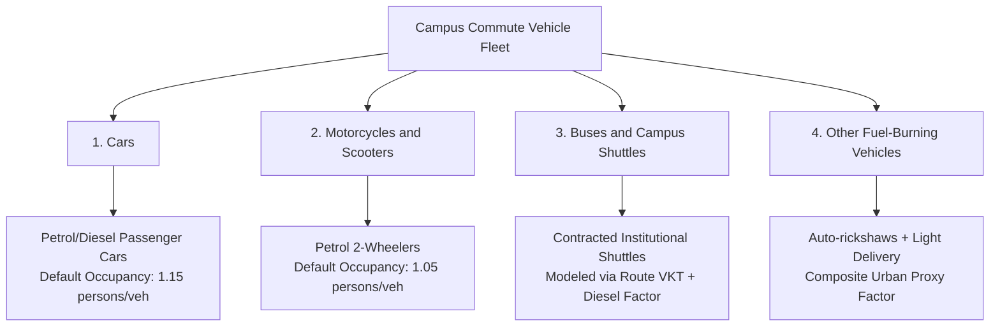
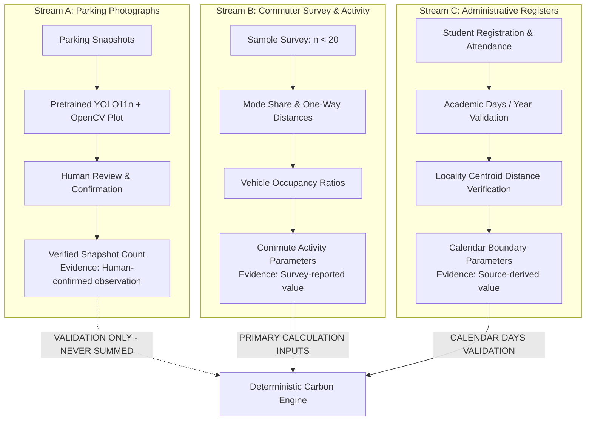
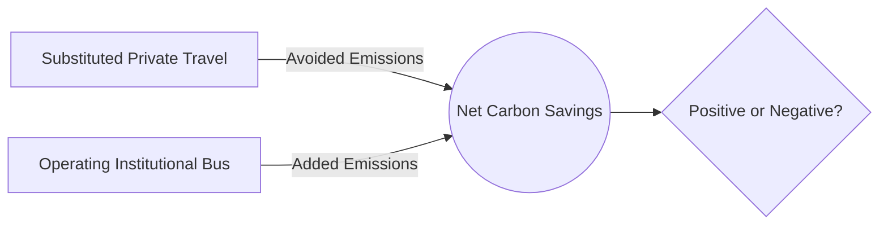

# Carbon Accounting & Modeling Methodology — TraceTwin

**Document Type:** Formal Scientific & Mathematical Methodology  
**Target Audience:** Environmental Data Analysts, Campus Sustainability Officers, Hackathon Evaluators  
**Last Updated:** October 15, 2026  
**Guiding Principle:** Deterministic mathematical control, transparent evidence provenance, and defensible emissions boundaries.

---

## 1. Accounting Scope & System Boundaries

### 1.1 Metric Scope: Direct Tailpipe $CO_2$
TraceTwin strictly quantifies **direct tailpipe carbon dioxide ($CO_2$) emissions** generated during the physical round-trip commute of university students, faculty, and administrative staff.

$$\text{Accounting Scope} \equiv \text{Scope 3, Category 7 (Employee \& Student Commuting) — Direct Mobile Tailpipe } CO_2$$

> [!IMPORTANT]
> **Boundary Exclusions Disclosed:**
> - **Upstream "Well-to-Tank" (WTT) Emissions:** Fuel extraction, refining, transport, and distribution emissions are **excluded**.
> - **Embodied / Lifecycle Emissions:** Vehicle manufacturing, battery lifecycle, and vehicle disposal emissions are **excluded**.
> - **Non-$CO_2$ Greenhouse Gases ($CH_4, N_2O$):** Tailpipe methane and nitrous oxide are excluded from the initial MVP due to the scarcity of verified vehicle-specific Indian emission factors for non-$CO_2$ gases. All values represent pure **$\text{kg } CO_2$**, not $\text{kg } CO_2e$.
> - **Active Transport:** Walking and cycling produce zero mobile tailpipe emissions. While promoted as healthy alternatives, they are not assigned negative emissions or artificial offsets.
> - **Electric Vehicles (EVs):** Excluded from the initial baseline calculation. Incorporating EVs requires dynamic charging logs, time-of-day charging curves, and regional grid emission factors (e.g., Central Electricity Authority of India $CO_2$ baseline database), which exceed the local 48-hour scope.

---

## 2. The Invariant Principle: Vehicle-Kilometres vs. Passenger-Kilometres

A pervasive, fatal error in corporate and campus carbon accounting is the conflation of **Vehicle-Kilometres Traveled (VKT)** with **Passenger-Kilometres Traveled (PKT)**.

| Metric | Formal Definition | Proper Factor Unit | Applicable Scenarios in TraceTwin |
| :--- | :--- | :---: | :--- |
| **Vehicle-Kilometres (VKT)** | The total physical distance traveled by motorized vehicles, regardless of passenger occupancy. | $\text{kg } CO_2/\text{veh-km}$ | **All personal vehicles (Cars, Motorcycles/Scooters, Auto-rickshaws, Institutional Shuttles).** |
| **Passenger-Kilometres (PKT)** | The aggregate distance traveled by passengers (Number of passengers $\times$ Distance). | $\text{kg } CO_2/\text{pass-km}$ | Used **only** when analyzing third-party public mass transit (e.g., municipal BMTC bus ridership) where individual vehicle fuel burn cannot be modeled. |

### The Unit Invariant Rule:
> **Never multiply a vehicle distance by a passenger-kilometre factor. Never multiply a passenger headcount directly by a vehicle-kilometre factor.**
> 
> If input data arrives as passenger headcount ($P_k$), the number of vehicles ($N_k$) must be derived using verified vehicle occupancy ($O_k$) before applying vehicle-kilometre emission factors:
> $$N_k = \frac{P_k}{O_k}$$

---

## 3. Core Baseline Calculation Formulas

For each supported vehicle category $k \in \{\text{Cars}, \text{Motorcycles}, \text{Buses}, \text{Other}\}$:

### Step 1: Annual Vehicle-Kilometres Traveled (VKT)
$$\text{VKT}_k (\text{km/year}) = N_k \times D_k \times 2 \times Y$$

Where:
- $N_k$: Average number of commuting vehicles operating on a typical campus day ($\text{vehicles/day}$).
- $D_k$: Average one-way road-route commute distance ($\text{km/trip}$).
- $2$: Multiplier representing the mandatory return journey (outbound from home to campus, inbound from campus to home).
- $Y$: Total number of active institutional commuting days per reporting period (default: $200 \text{ academic days/year}$).

### Step 2: Annual Category Tailpipe $CO_2$ Emissions
$$\text{Emissions}_k (\text{kg } CO_2/\text{year}) = \text{VKT}_k \times EF_k$$

Where:
- $EF_k$: Verified tailpipe emission factor for vehicle category $k$ ($\text{kg } CO_2/\text{veh-km}$).

### Step 3: Total Baseline Campus Commute Emissions
$$\text{Total Baseline } (t CO_2/\text{year}) = \frac{\sum_{k} \text{Emissions}_k}{1000}$$

Where:
- $1000$: Exact conversion factor ($1 \text{ metric tonne} = 1000 \text{ kg}$).

---

## 4. Vehicle Category Classification & Treatment

TraceTwin models exactly four vehicle categories. Each category exhibits distinct occupancy, fuel characteristics, and modeling assumptions:

### 4.1 Category 1: Cars
- **Scope:** Passenger sedans, hatchbacks, and SUVs running on petrol, diesel, or compressed natural gas (CNG).
- **Default Occupancy Assumption:** $1.15 \text{ persons/vehicle}$ (predominantly single-occupancy student/faculty driving).
- **Emission Factor Benchmark:** Based on India GHG Program / ARAI road transport averages for passenger cars ($0.140\text{--}0.160 \text{ kg } CO_2/\text{veh-km}$).

### 4.2 Category 2: Motorcycles and Scooters
- **Scope:** Motorized two-wheelers running on petrol (four-stroke and two-stroke internal combustion engines).
- **Default Occupancy Assumption:** $1.05 \text{ persons/vehicle}$ (overwhelmingly solo riders, occasional pillion passenger).
- **Emission Factor Benchmark:** Significantly lower than cars per vehicle-km ($0.030\text{--}0.045 \text{ kg } CO_2/\text{veh-km}$), but represents high total volume on Indian university campuses.

### 4.3 Category 3: Buses and Campus Shuttles
- **Scope:** Dedicated university-operated or contracted diesel buses transporting students and faculty along fixed routes.
- **Modeling Requirement:** Must be modeled via **vehicle route distance** rather than passenger headcount.
- **Default Occupancy:** $35\text{--}50 \text{ passengers/bus}$.
- **Emission Factor Benchmark:** Standard diesel coach factor ($0.800\text{--}1.100 \text{ kg } CO_2/\text{veh-km}$).

### 4.4 Category 4: Other Fuel-Burning Vehicles (Including Auto-Rickshaws)
- **Scope:** Three-wheeled passenger auto-rickshaws (CNG/LPG/Petrol) used as first/last-mile campus transit, alongside campus utility delivery vans.
- **Methodological Limitation:** This is a composite category. Auto-rickshaws exhibit lower emissions ($~0.065\text{--}0.080 \text{ kg } CO_2/\text{veh-km}$) than light diesel utility trucks ($~0.220 \text{ kg } CO_2/\text{veh-km}$).
- **Mitigation:** The system documents the composite proxy factor used ($0.080 \text{ kg } CO_2/\text{veh-km}$) and provides users with explicit manual override capability in the methodology drawer.

---

## 5. Strict Separation of Disparate Evidence Streams

To preserve scientific validity, TraceTwin enforces complete computational isolation between its three primary data streams:

### 5.1 Parking Photograph Limitations
- **Snapshot in Time:** A photograph of 200 parked vehicles at 11:00 AM does not equal 200 daily unique commuters. It ignores afternoon turnover, morning drop-offs, and late arrivals.
- **Double Counting Across Photos:** Photos taken at 10:00 AM and 2:00 PM capture many of the exact same vehicles. Naively summing them doubles the counted fleet.
- **Off-Campus Blindness:** Vehicles parked on public perimeter roads outside the campus gates are invisible to on-campus parking cameras.
- **TraceTwin Rule:** Parking photographs are used solely for **computer-vision spot audits and capacity verification**. They are **never** directly multiplied into the annual baseline emissions total without an explicit, calibrated turnover model.

### 5.2 Attendance Register Limitations
- **Presence $\ne$ Mode:** An attendance record confirms that a student was physically present in a lecture hall. It provides **zero evidence** of whether they walked, rode a bicycle, shared a car, or took a public bus.
- **Hometown Address Bias:** Registered addresses in university databases frequently record permanent family hometowns (e.g., hundreds of kilometres away) rather than local rental apartments or hostels.
- **TraceTwin Rule:** Attendance records are used strictly to audit the number of annual operating days ($Y$) and to validate aggregate locality clusters. Individual attendance logs are never treated as transport mode logs.

### 5.3 Survey Sampling Limitations ($n < 20$)
- **Sample Non-Representativeness:** A sample size of fewer than 20 student responses cannot represent a campus population of 4,000+ students. It is subject to self-selection bias and high variance.
- **TraceTwin Rule:** The primary dashboard metric must be labeled **"Sample-Based Baseline"** ($n=18$). Campus-wide projection is locked behind an explicit user toggle requiring affirmative acceptance of extrapolation assumptions.

---

## 6. Special Commute Case Modeling

### 6.1 Carpooling Modeling & Detour Penalty
Carpooling consolidates multiple solo drivers into a single vehicle. However, picking up carpool partners requires route deviations.
- **Detour Penalty Factor ($D_{\text{detour}}$):** Modeled at **$1.10$** (10% additional route distance).
- **Avoided Vehicles Formula:**
  If $N_{\text{shift}}$ solo drivers agree to carpool at an occupancy of $O_{\text{pool}}$:
  $$N_{\text{pool\_vehicles}} = \left\lceil \frac{N_{\text{shift}}}{O_{\text{pool}}} \right\rceil$$
  $$\Delta N_{\text{car}} = N_{\text{shift}} - N_{\text{pool\_vehicles}}$$
- **Adjusted Travel Distance:**
  $$D_{\text{pool}} = D_{\text{car}} \times D_{\text{detour}} = D_{\text{car}} \times 1.10$$
- **Net Avoided Emissions:**
  $$\text{Avoided Car Emissions } (\text{kg } CO_2) = \left( (N_{\text{shift}} \times D_{\text{car}} \times 2 \times Y) - (N_{\text{pool\_vehicles}} \times D_{\text{pool}} \times 2 \times Y) \right) \times EF_{\text{car}}$$

### 6.2 Drop-Off Commutes (The "Kiss-and-Ride" Paradox)
When a student is dropped off by car or auto-rickshaw:
- The vehicle completes a return trip ("deadhead" travel) back to its origin without the student.
- The vehicle **does not park on campus**, making it invisible in parking photographs.
- Total commute distance for a drop-off is $4 \times D$ (Drop-off round trip + Evening pick-up round trip).
- **TraceTwin Rule:** Drop-offs are captured via survey mode share as separate trips to prevent severe under-counting of vehicle-kilometres.

### 6.3 Institutional Bus & Campus Shuttle Modeling (Added Fuel Accounting)
Introducing an institutional bus service reduces private car and motorcycle traffic, but introduces heavy diesel fuel combustion.

- **Avoided Private Emissions:**
  $$\text{Avoided Private } (\text{kg } CO_2) = \sum_{m \in \{\text{cars, motos}\}} \left( \Delta N_m \times D_m \times 2 \times Y \times EF_m \right)$$
- **Added Shuttle Emissions (Mandatory Calculation):**
  $$\text{VKT}_{\text{shuttle}} = R \times T_{\text{trips}} \times (D_{\text{shuttle}} \times 2) \times Y$$
  $$\text{Added Emissions}_{\text{shuttle}} (\text{kg } CO_2) = \text{VKT}_{\text{shuttle}} \times EF_{\text{shuttle}}$$
  Where $R$ is the number of routes, $T_{\text{trips}}$ is daily roundtrips, and $D_{\text{shuttle}}$ is one-way route distance.
- **Net Scenario Balance:**
  $$\text{Net Avoided } (t CO_2) = \frac{\text{Avoided Private} - \text{Added Shuttle}}{1000}$$
  *If Added Shuttle > Avoided Private (due to low student ridership), Net Avoided is negative, alerting planners that the shuttle policy currently worsens campus emissions.*

---

## 7. The Six Evidence Provenance Labels

To maintain scientific integrity and auditability, every metric on the user interface is tagged with one of six standardized evidence labels:

| Label | Technical Definition | UI Rendering | Example Field |
| :--- | :--- | :---: | :--- |
| `[Direct observation]` | Measured directly via raw automated sensors or CV detection without modification. | Blue Tag | Raw YOLOv8n car detection box. |
| `[Human-confirmed observation]` | A direct observation that has been inspected, modified, or validated by a human. | Green Tag | Verified parking lot vehicle count. |
| `[Survey-reported value]` | Data collected directly from commuter survey responses. | Purple Tag | Average one-way distance ($D_k = 14.2 \text{ km}$). |
| `[Source-derived value]` | A published conversion factor or statutory academic parameter. | Amber Tag | Emission factor ($EF_{\text{car}} = 0.145 \text{ kg } CO_2/\text{km}$). |
| `[Assumption]` | An unverified heuristic or policy threshold adopted for modeling. | Gray Tag | Carpool detour penalty ($1.10$). |
| `[Derived calculation]` | A mathematical output generated by deterministic formulas from the above inputs. | Teal Tag | Annual Baseline ($142.8 \text{ tonnes } CO_2$). |

---

## 8. Anti-Double-Counting Rules

TraceTwin enforces four absolute anti-double-counting constraints:
1. **No Photo + Survey Summing:** The system database does not allow parking observation counts to be added to survey vehicle counts.
2. **No Multi-Photo Direct Summing:** Uploading photos of the same parking lot across different hours requires specifying whether they represent distinct lots or time-series audits of the same lot.
3. **No Passenger-km Overlap:** Personal vehicle emissions are calculated exclusively via vehicle-kilometres. Passenger occupancy is used solely as a divisor to prevent counting individual passengers as separate vehicles.
4. **No Combined Scenario Compounding:** In the hackathon MVP, scenarios are evaluated independently against the baseline to prevent double-counting overlapping savings (e.g., claiming 100% of carpool savings and 100% of shuttle savings from the same commuter cohort).

---

## 9. Source Verification & Factor Provenance Checklist

Before any emission factor is adopted into the platform database, the following ten-point verification checklist must be satisfied:

- [ ] **Factor Identifier:** Uniquely assigned (e.g., `EF_CAR_IN_01`).
- [ ] **Exact Unit:** Stated explicitly in $\text{kg } CO_2/\text{veh-km}$ (or explicit conversion documented).
- [ ] **Specific Vehicle Class:** Mapped to one of the four supported categories.
- [ ] **Fuel / Powertrain Specification:** Stated (e.g., Petrol 4-stroke, Diesel BS-VI, CNG).
- [ ] **Geographic Context:** Verified as India-specific or regionally adjusted.
- [ ] **Metric Scope:** Confirmed as tailpipe $CO_2$ (not mixed with lifecycle $CO_2e$).
- [ ] **Source Title & Author:** Documented (e.g., India GHG Program, ARAI, CPCB).
- [ ] **Source Publication Year:** Documented (must be $\ge 2015$ where available).
- [ ] **Source URL / Citation:** Accessible web link or academic citation provided.
- [ ] **Approximation Disclosures:** Documented engine mix and speed cycle limitations.
