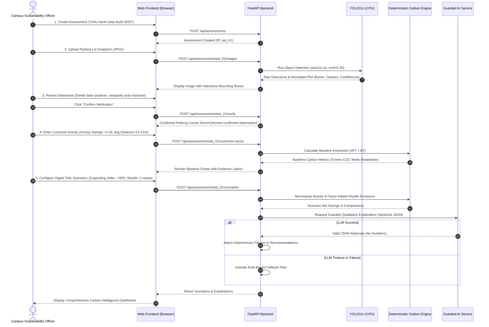

# Product Requirements Document (PRD) — TraceTwin

**Document Status:** `Proposed`  
**Current Stage:** Requirements & Planning  
**Last Updated:** October 15, 2026  
**Authors:** TraceTwin Product & Architecture Team  

---

## 1. Product Summary

**TraceTwin** is an environmental data intelligence platform designed for university campuses to quantify, analyze, and simulate interventions for commute-related vehicular carbon emissions. 

By unifying physical parking snapshots, computer vision object detection, human verification workflows, defensible carbon accounting mathematics, Digital Twin scenario simulation, and guarded Generative AI, TraceTwin empowers university leadership to transition from speculative sustainability gestures to evidence-backed, measurable decarbonization strategies.

---

## 2. Problem Statement

University campuses are major regional traffic attractors, generating substantial indirect Scope 3 greenhouse gas (GHG) emissions from the daily transit of students, faculty, and administrative staff. Despite mounting institutional commitments to carbon neutrality, campus sustainability teams face four critical bottlenecks:

1. **Empirical Data Scarcity:** Campus commute habits are poorly understood. Institutions rarely possess comprehensive origin-destination matrices or mode-share breakdowns, relying instead on sporadic, low-response annual surveys.
2. **Snapshot Misinterpretation:** Well-intentioned campus audits frequently equate instant parking counts with total daily unique commuters, drastically distorting baseline carbon assessments.
3. **Black-Box & Defective Accounting:** Existing campus carbon tools often mix vehicle-kilometres with passenger-kilometres, apply outdated Western emission factors to Indian vehicular fleets, or hide assumptions inside impenetrable spreadsheets.
4. **Paralysis in Policy Intervention:** Campus decision-makers cannot forecast whether an expensive electric shuttle, a carpooling parking rebate, or a hybrid schedule policy will yield tangible carbon reductions or inadvertently generate net-positive emissions.

---

## 3. Target Users & Personas

| Persona | Role | Primary Needs | Key Pain Points |
| :--- | :--- | :--- | :--- |
| **Dr. Ananya Sharma** | Campus Sustainability Director | Defensible, audit-ready carbon baseline numbers for institutional reporting (NAAC, NIRF, AASHE STARS). | Distrusts subjective student surveys; lacks empirical traffic validation; fears greenwashing accusations. |
| **Vikram Rathod** | Head of Campus Transport & Security | Traffic congestion relief, parking space optimization, shuttle route justification. | Manual gate logs are unaggregated; no visibility into commuter origin clusters; high friction in parking management. |
| **Rohan Mehta** | Student Eco-Club President | Persuasive data to advocate for institutional carpooling lanes and student bus subsidies. | Lacks tools to show administrators the measurable emissions savings of proposed student-led campaigns. |
| **Hackathon Evaluator** | Environmental Data / AI Judge | Verification of scientific rigor, computer vision execution, guarded AI integration, and live demonstration viability. | Skeptical of AI hallucinations, fabricated numbers, and bloated untested architectures. |

---

## 4. Goals and Non-Goals

### 4.1 Product Goals
- **G-1 (Defensible Baseline):** Deliver an auditable tailpipe carbon emissions estimate for campus commutes based on verified empirical evidence and documented emission factors.
- **G-2 (Computer Vision Validation):** Provide an intuitive computer vision pipeline allowing campus administrators to upload parking lot photographs, automatically detect vehicle categories, and manually review/correct detections in a closed human-in-the-loop workflow.
- **G-3 (Digital Twin Simulation):** Enable users to model three distinct campus decarbonization scenarios (fewer commute days, carpooling incentives, institutional bus/shuttle network) with full accounting for rebound or added emissions.
- **G-4 (Guarded AI Intelligence):** Employ Generative AI strictly for narrative policy explanation and qualitative ranking, preventing hallucinated numerical emissions values through deterministic schema validation and rule-based fallback.
- **G-5 (Methodological Transparency):** Explicitly communicate data provenance, sample size limitations, and coverage boundaries, clearly separating sample-derived findings from campus-wide projections.

### 4.2 Non-Goals
- **NG-1 (No Automated Total Campus Extrapolation):** The system will not automatically multiply an unrepresentative sample (<20 responses) to represent the entire campus population without explicit, user-configured assumption toggles.
- **NG-2 (No Live Surveillance or Facial Recognition):** The platform will not track individual vehicle license plates (ALPR), recognize driver faces, or monitor live continuous CCTV video feeds.
- **NG-3 (No Real-Time Navigation Engine):** TraceTwin is an emissions modeling tool, not a live turn-by-turn routing or GPS tracking application.
- **NG-4 (No Baseline Electric Vehicle Accounting):** EVs, electric charging load, and grid lifecycle factors are excluded from the initial hackathon baseline.
- **NG-5 (No Public Cloud Deployment Required):** The platform is strictly designed to operate locally on a single machine for the hackathon demonstration.

---

## 5. Confirmed Architectural & Product Decisions

Treat the following as current working requirements (`Confirmed` by team):
1. **Local Single-Laptop Deployment:** Application runs locally via a lightweight client-server architecture (FastAPI backend, SQLite database, Vanilla HTML/CSS/JS frontend).
2. **Hybrid Evidence Approach:** Independent ingestion of (a) parking snapshot photographs, (b) human detection review, (c) aggregate commute statistics, and (d) survey samples.
3. **Four Core Vehicle Categories:** Cars, Motorcycles and scooters, Buses and campus shuttles, and Other fuel-burning vehicles (including auto-rickshaws).
4. **Explicit Exclusions:** Walking, cycling, and electric vehicles (EVs) are excluded from the initial baseline calculation.
5. **Distance Determination:** Road-route distance estimated via mapping service using minimized locality/zone data, avoiding exact residential street addresses.
6. **Deterministic Numerical Authority:** All baseline and scenario calculations are strictly computed by a deterministic Python engine. AI is prohibited from generating or modifying numerical emissions claims.
7. **Guarded AI Fallback:** The LLM output is parsed against a strict schema. Any timeout, network failure, or schema violation triggers a deterministic, rule-based explanation labeled "Rule-based plan (AI unavailable)".
8. **Three Core Scenarios:** (1) Fewer commute days, (2) Carpooling, and (3) Bus/shuttle intervention.

---

## 6. Functional Requirements

### 6.1 Assessment Setup (FR-1)
- **FR-1.1:** The user shall be able to create a named Assessment (e.g., "Engineering Block Autumn Audit 2026").
- **FR-1.2:** The user shall specify the reporting period (e.g., Annual, Semester, Monthly) and annual operating days (default: 200 academic days).
- **FR-1.3:** The user shall select the target campus area or parking facility name.

### 6.2 Parking Image Upload & Computer Vision Pipeline (FR-2)
- **FR-2.1:** The user shall upload JPEG or PNG photographs of campus parking areas.
- **FR-2.2:** The backend shall process images through a pretrained Ultralytics YOLO11 Nano model (`yolo11n.pt`) on local CPU (`conf=0.35`).
- **FR-2.3:** The system shall map detected COCO classes to TraceTwin categories:
  - COCO class 1 `bicycle` $\rightarrow$ Active transit observation (counted in vehicle report, excluded from tailpipe carbon baseline).
  - COCO class 2 `car` $\rightarrow$ **Cars**
  - COCO class 3 `motorcycle` $\rightarrow$ **Motorcycles and scooters**
  - COCO class 5 `bus` $\rightarrow$ **Buses and campus shuttles**
  - COCO class 7 `truck` $\rightarrow$ **Other fuel-burning vehicles, including auto-rickshaws** (with manual correction available)
- **FR-2.4:** The system shall display detection confidence scores, normalized coordinates, and generate OpenCV annotated plot images (`results[0].plot()`).
- **FR-2.5:** The system shall explicitly record parking photo counts as snapshot observations, not daily unique commuters.

### 6.3 Human Verification Workflow (FR-3)
- **FR-3.1:** The frontend shall render interactive bounding box overlays on top of the uploaded parking photograph.
- **FR-3.2:** The user shall be able to delete false-positive detections.
- **FR-3.3:** The user shall be able to reclassify an incorrect vehicle class (e.g., reassigning an auto-rickshaw detected as a truck or car to "Other fuel-burning vehicles").
- **FR-3.4:** The user shall be able to manually draw a bounding box to add an unspotted vehicle.
- **FR-3.5:** The user shall click a "Confirm Verification" button, converting the raw detections into a permanent `Human-confirmed observation` record.

### 6.4 Commute Data & Survey Ingestion (FR-4)
- **FR-4.1:** The system shall ingest aggregate commute inputs across the four vehicle categories:
  - Daily commuting vehicles count ($N_k$)
  - Average one-way commute distance in kilometres ($D_k$)
  - Vehicle occupancy ratio ($O_k$)
  - Commuting days per academic year ($Y$)
- **FR-4.2:** The system shall support importing anonymized survey results, displaying sample size ($n$) and warning if $n < 20$.
- **FR-4.3:** The system shall restrict origin inputs to postal code, neighborhood, or locality names to enforce data minimization.

### 6.5 Deterministic Carbon Calculation Engine (FR-5)
- **FR-5.1:** The calculation engine shall compute annual vehicle-kilometres for each category:
  $$\text{VKT}_k = N_k \times D_k \times 2 \times Y$$
- **FR-5.2:** The engine shall calculate annual tailpipe $CO_2$ emissions using verified emission factors ($EF_k$ in $\text{kg } CO_2/\text{veh-km}$):
  $$\text{Emissions}_k (\text{kg } CO_2) = \text{VKT}_k \times EF_k$$
- **FR-5.3:** Total baseline emissions shall be calculated and converted to metric tonnes ($t CO_2$):
  $$\text{Total Baseline } (t CO_2) = \frac{\sum_k \text{Emissions}_k}{1000}$$
- **FR-5.4:** The engine shall strictly forbid multiplying passenger counts directly by vehicle-kilometre emission factors.

### 6.6 Digital Twin Scenario Simulation (FR-6)
- **FR-6.1 (Scenario 1: Fewer Commute Days):** Model remote learning or compressed work-weeks by reducing annual commute days ($Y$) or selected mode travel days by a percentage ($P_{\text{remote}}$).
- **FR-6.2 (Scenario 2: Carpooling):** Model carpool incentives by increasing car occupancy ($O_{\text{car}}$), reducing total personal car trips by an avoided factor, while factoring in a 10% average route detour penalty ($D_{\text{detour}} = 1.10$).
- **FR-6.3 (Scenario 3: Bus / Shuttle Intervention):** Model institutional bus adoption by shifting commuters from private two-wheelers and cars into campus shuttles. The engine **must add the shuttle's fuel-burning emissions** to total scenario emissions based on route distance and daily operating trips.
- **FR-6.4 (Net Savings Output):** The engine shall compute:
  $$\text{Net Savings } (t CO_2) = \text{Baseline Emissions} - \text{Scenario Emissions}$$
  If scenario emissions exceed baseline, the system must clearly display a negative savings value (added emissions).

### 6.7 Guarded AI Policy Explanations (FR-7)
- **FR-7.1:** The backend shall format aggregate scenario results into a sanitized, non-PII prompt for the Generative AI service.
- **FR-7.2:** The LLM prompt shall strictly forbid the model from inventing or calculating numerical emissions figures.
- **FR-7.3:** The backend shall enforce structured JSON output containing:
  - `recommendation_id` (from an approved institutional catalog)
  - `scenario_title`
  - `qualitative_rationale`
  - `implementation_difficulty` (Low / Medium / High)
  - `policy_actions` (ordered list of steps)
- **FR-7.4:** The backend shall validate the returned JSON. Any hallucinated numbers or invalid schema shall be rejected.
- **FR-7.5:** In case of API failure, timeout (bounded to 4000ms), or schema rejection, the system shall seamlessly fall back to deterministic, rule-based recommendations labeled:  
  `"Rule-based plan (AI unavailable)"`.

### 6.8 Methodology & Reporting Dashboard (FR-8)
- **FR-8.1:** The dashboard shall display interactive emissions breakdowns by vehicle category and scenario comparisons.
- **FR-8.2:** Every numerical metric on the UI shall display its **Evidence Label**:
  - `[Direct observation]`
  - `[Human-confirmed observation]`
  - `[Survey-reported value]`
  - `[Source-derived value]`
  - `[Assumption]`
  - `[Derived calculation]`
- **FR-8.3:** The UI shall display a prominent methodology panel revealing all formulas, active emission factors, source URLs, geographic applicability, and sample size limitations.
- **FR-8.4:** The user shall be able to export or print a self-contained HTML/PDF carbon intelligence audit summary.

---

## 7. Non-Functional Requirements (NFRs)

### 7.1 Performance & Resource Efficiency
- **NFR-1.1:** The computer vision pipeline must execute inference on an image of resolution $1920 \times 1080$ in less than 3.5 seconds on a standard 4-core CPU without dedicated GPU acceleration.
- **NFR-1.2:** Deterministic calculations across all four vehicle categories and three scenarios must complete in under 50 milliseconds.
- **NFR-1.3:** Total application RAM footprint must not exceed 1.5 GB on the host laptop.

### 7.2 Privacy, Data Protection & Minimization
- **NFR-2.1:** No Personally Identifiable Information (PII)—including student names, roll numbers, exact residential street addresses, or raw student ID card photographs—shall be stored in the application database.
- **NFR-2.2:** Geographic origin data must be restricted to coarse locality, ward, or postal code identifiers.
- **NFR-2.3:** No individual student attendance records or raw photos shall be transmitted to third-party cloud APIs (including mapping services or LLMs). Only aggregate centroid-to-campus distance coordinates and non-PII summary metrics may be transmitted.

### 7.3 Reliability & Resilience
- **NFR-3.1:** The application must remain fully functional offline for baseline carbon accounting and scenario modeling, degrading gracefully if internet connectivity for mapping or LLM APIs is unavailable.
- **NFR-3.2:** LLM API integration must have an automated 4-second timeout with zero UI crash impact, triggering immediate deterministic fallback.

### 7.4 Maintainability & Code Quality
- **NFR-4.1:** Architecture must maintain a clean separation of concerns: decoupled frontend presentation, REST API endpoints, dedicated carbon calculation module, and isolated CV worker.
- **NFR-4.2:** Code written during the hackathon must feature clear inline comments, explicit unit annotations in variable names (e.g., `dist_km`, `emissions_kg_co2`), and adhere to PEP 8 standards.

### 7.5 Usability for Beginners
- **NFR-5.1:** The user interface must require zero terminal commands once launched. All adjustments, verification bounding boxes, and scenario sliders must operate through standard web controls.

---

## 8. Main User Journey

---

## 9. Feature Priorities (MoSCoW Matrix)

| Priority | Feature Description | Rationale |
| :--- | :--- | :--- |
| **Must-Have** | • Single-laptop local server execution (FastAPI + SQLite). • Parking photo upload with local CPU YOLO11n inference (`conf=0.35`). • Human verification bounding-box review interface (delete, edit class, add box). • Deterministic baseline calculation engine ($\text{VKT} \times EF$) with explicit units. • Separation of snapshot parking observations from daily commute inputs. • Three Digital Twin scenarios (Fewer Days, Carpooling, Shuttle with added emissions). • Guarded AI explanation with automated deterministic rule-based fallback. • Evidence labeling for every metric on the dashboard. | Core MVP required to satisfy hackathon track, deliver high visual impact, and uphold scientific integrity. |
| **Should-Have** | • Exportable audit summary report in print-ready HTML/PDF format. • Locality-to-campus distance lookup via mapping API. • Sample size sensitivity toggle (sample-based baseline vs. explicit campus projection). • Interactive Chart.js mode-share and scenario comparison visualizations. | Essential for executive polish, visual impact, and rigorous evaluator inspection. |
| **Could-Have** | • Multi-lot parking aggregation (comparing North vs. South gate occupancy). • Weather condition tag for parking photos (e.g., monsoon vs. clear day commute bias). • Preset municipal transit routes for auto-rickshaw feeder modeling. | Valuable enhancements if core workstreams finish ahead of schedule. |
| **Out-of-Scope** | • Automated License Plate Recognition (ALPR) or vehicle tracking. • Electric Vehicle (EV) charging load and grid-intensity emissions modeling. • Active transit (walking and cycling) emissions modeling. • Live video stream / continuous CCTV RTSP camera ingestion. • Multi-tenant cloud SaaS deployment, authentication, or OAuth2. | Excluded to eliminate security risks, prevent technical bloat, and protect 48-hr execution. |

---

## 10. Data Inputs & Outputs Summary

### 10.1 System Inputs
- **Parking Snapshot Photographs:** JPEG/PNG digital files (minimum $1280 \times 720$, maximum 10 MB per file).
- **Human Verification Edits:** Additions, deletions, and class reassignments submitted via the canvas editor.
- **Commute Activity Parameters:** Mode vehicle counts ($N_k$), one-way distance ($D_k$), occupancy ($O_k$), academic days ($Y$).
- **Sample Metadata:** Survey sample count ($n$), target campus student/staff population ($P_{\text{total}}$).
- **Scenario Sliders:** Percentage remote schedule ($0\text{--}50\%$), carpool mode shift ($0\text{--}60\%$), institutional shuttle routes and daily roundtrips ($1\text{--}10$).

### 10.2 System Outputs
- **Verified Parking Snapshot Count:** Classified counts per vehicle category with timestamp and observer tag.
- **Annual Vehicle-Kilometres Traveled (VKT):** Distance quantified by category ($\text{km/year}$).
- **Tailpipe $CO_2$ Baseline Emissions:** Quantified in $\text{kg } CO_2$ and metric tonnes ($t CO_2$) per vehicle category and total.
- **Digital Twin Scenario Projections:** Forecasted gross emissions, avoided emissions, added transit emissions, and net avoided $CO_2$.
- **AI Policy Plan:** Formatted recommendations with qualitative logic and deterministically attached savings figures.
- **Audit & Provenance Disclosures:** Full disclosure of factor sources, formulas, approximations, and sample coverage warnings.

---

## 11. Privacy & Ethical Safeguards

1. **Strict Data Minimization:** The system refuses to accept or store student identification numbers, full residential street addresses, or names. Commuter origins are normalized to generalized geographic localities (e.g., "Jayanagar 4th Block", "Electronic City Phase 1", "Kengeri").
2. **No Persistent Photographic Facial / Plate Storage:** Parking photographs are processed in local volatile memory. Images are retained locally solely for the duration of the audit session. No automated facial extraction or license plate indexing is implemented.
3. **Third-Party AI Isolation:** Zero photographs, personal metadata, or raw survey responses are transmitted to the external Generative AI API. Only aggregate, non-identifiable numerical summaries are passed to the prompt payload.
4. **Third-Party Mapping Isolation:** When estimating commute distances, origin coordinates are passed as generalized neighborhood centroids without linking user identifiers or timestamps.

---

## 12. Critical Project Risks & Mitigation Matrix

The following 14 critical risks represent foundational architectural and methodological hazards that must be actively managed:

| Risk ID | Hazard Description | Severity | Likelihood | Mitigation Strategy | Owner Role |
| :---: | :--- | :---: | :---: | :--- | :--- |
| **R-01** | **Parking photo confused with daily unique commuters:** Users assume a photo of 150 cars equals 150 daily commuting cars. | High | High | Enforce strict UI separation; label photo counts as `[Direct observation]` snapshot counts; require separate commute input entry. | Environmental Data Analyst |
| **R-02** | **Multiple photos double-count identical vehicles:** Photos taken across different hours capture the same parked vehicles. | High | Medium | UI warning on photo aggregation; explicitly treat each photo as a single point-in-time audit; disable naive multi-photo summing. | CV Specialist |
| **R-03** | **Parking photos miss drop-offs and off-campus parkers:** Commuters dropped by parents/rickshaws or parked outside gates are invisible. | Medium | High | Methodology documentation explicitly flags parking capture blindness; survey inputs capture drop-off mode shares independently. | Environmental Data Analyst |
| **R-04** | **Attendance registers do not establish commute mode:** Register proves presence on campus, but cannot indicate if travel was by car, bus, or walk. | High | High | Prohibit deriving vehicle category share from attendance alone; use attendance strictly to validate annual active days ($Y$). | Data Architect |
| **R-05** | **Student registered addresses outdated or non-commute origins:** Addresses in records reflect permanent hometowns, not local student hostels or rentals. | Medium | High | Use anonymized survey origin inputs as the primary commute distance baseline; label register-derived distances with high-uncertainty flags. | Privacy Reviewer |
| **R-06** | **Unrepresentative survey sample ($n < 20$):** Small sample creates statistical bias, invalidating naive campus-wide multiplication. | High | High | Display sample size prominently; default headline metric to "Sample-Based Baseline"; mandate explicit assumptions before showing projections. | Environmental Data Analyst |
| **R-07** | **Mixing passenger-km and vehicle-km factors:** Multiplying vehicle distance by passenger-kilometre emission factors skews totals by orders of magnitude. | Critical | Medium | Strictly type calculation engine inputs; enforce `kg CO2/veh-km` for all personal vehicles; unit-tested validation rules in engine. | Software Architect |
| **R-08** | **Fixed category factors poor approximation for mixed classes:** "Other fuel-burning vehicles" lumps 2-stroke autos, 4-stroke autos, and utility vans. | Medium | High | Document approximation limits in Methodology panel; cite specific source proxy used; provide user override capability for factor values. | Environmental Data Analyst |
| **R-09** | **Bus/shuttle intervention inadvertently adds emissions:** An empty or low-occupancy shuttle burns more fuel than the private vehicles it replaces. | High | Medium | Formula explicitly computes added shuttle diesel emissions ($VKT_{\text{shuttle}} \times EF_{\text{shuttle}}$); flags negative net savings. | Environmental Data Analyst |
| **R-10** | **Generative AI hallucinates emissions numbers or savings:** LLM invents statistical claims or alters verified mathematical outputs. | Critical | High | LLM prompt contains zero calculation responsibility; backend strips unapproved numbers; deterministically injects engine values. | AI Guard Engineer |
| **R-11** | **Third-party mapping API leaks student origin data:** Passing raw student addresses to external geocoding/routing APIs breaches privacy. | High | Medium | Pass only generalized locality centroids (e.g., ward name or pincode center); execute privacy audit before enabling external calls. | Privacy Reviewer |
| **R-12** | **Student address & attendance register privacy exposure:** Exposing individual student records in local database or demo screens violates regulations. | Critical | Low | Prohibit storing per-student records in the application database; process data in memory to create aggregate category distributions only. | Privacy Reviewer |
| **R-13** | **48-Hour hackathon integration and debugging crunch:** Beginner team members struggle to connect CV, backend, and frontend before deadline. | High | High | Freeze shared API contract in Hour 3; deliver walking skeleton by Hour 14; appoint dedicated Integration Owner; maintain strict cut line. | Integration Owner |
| **R-14** | **Hackathon disqualification for pre-built code:** Violating event rule that all code must be authored during the active hackathon window. | Critical | Low | Strictly produce documentation, specifications, and schemas prior to kickoff; author 100% of code live during the 48-hour event. | Lead Product Manager |

---

## 13. Acceptance Criteria

### 13.1 Assessment & Ingestion
- [ ] System creates an Assessment record with name, period, and campus location.
- [ ] User can upload a JPEG/PNG image up to 10 MB.
- [ ] Backend runs YOLO11n object detection locally without throwing memory or CPU exceptions.
- [ ] Detections appear visually as bounded rectangles with category label and confidence score.

### 13.2 Human-in-the-Loop Review
- [ ] User can click on any bounding box to delete it.
- [ ] User can click a dropdown on a box to change its category (e.g., Car to Bus).
- [ ] User can draw a new bounding box and assign a category.
- [ ] Saving updates the persistent count and assigns the `[Human-confirmed observation]` evidence label.

### 13.3 Carbon Calculation Engine
- [ ] Baseline emissions formula matches $\text{VKT} \times EF$ exactly.
- [ ] Changing one-way distance, vehicle counts, or operating days triggers instant recalculation.
- [ ] Output displays both $\text{kg } CO_2$ and metric tonnes ($t CO_2$) with correct unit conversions ($1 t = 1000 \text{ kg}$).
- [ ] Engine rejects negative distances, negative vehicle counts, or negative days with clean validation errors.

### 13.4 Digital Twin Scenarios
- [ ] Adjusting "Fewer Commute Days" slider proportionally reduces baseline VKT and emissions.
- [ ] Adjusting "Carpooling" increases average car occupancy and reduces personal car VKT while factoring in the 10% detour penalty.
- [ ] Adjusting "Bus/Shuttle Intervention" calculates avoided personal vehicle trips AND calculates added shuttle emissions.
- [ ] If added shuttle emissions exceed avoided car emissions, the system shows negative net savings in red without crashing.

### 13.5 Guarded AI & Fallback
- [ ] AI prompt receives zero student identifiers, exact addresses, or raw photos.
- [ ] AI returns structured JSON with approved recommendation IDs.
- [ ] Numerical savings values displayed next to AI recommendations are supplied exclusively by the deterministic engine.
- [ ] Disconnecting the internet or killing the LLM API key causes the UI to render the deterministic rule-based fallback plan within 4 seconds, clearly labeled `"Rule-based plan (AI unavailable)"`.

---

## 14. Hackathon Success Criteria (Live Demo Readiness)

A successful 48-hour hackathon demonstration must achieve the following milestones live on the evaluation laptop:
1. **Flawless End-to-End Walkthrough:** Complete the full user journey (Image upload $\rightarrow$ CV detection $\rightarrow$ Human edit $\rightarrow$ Survey baseline $\rightarrow$ Scenario modeling $\rightarrow$ Guarded AI plan) in under 4 minutes without console errors or server reboots.
2. **Defensible Evaluator Defense:** Demonstrate that every number on the screen can be traced to an explicit mathematical formula and verified emission factor in the methodology drawer.
3. **Live AI Guardrail Demonstration:** Intentionally induce an AI timeout or network disconnect to prove that the application degrades gracefully to the rule-based fallback without breaking the demo.
4. **Zero Pre-Built Code Infraction:** Provide clean Git commit history showing all code authored during the official hackathon window.

---

## 15. Future Scope (Post-Hackathon Roadmap)

Following the Code Clash 2.0 hackathon, the TraceTwin platform can expand into a full-scale institutional product:
- **Phase 2 (Electric Vehicle Modeling):** Introduce an EV transition scenario incorporating India CEA grid carbon factors, campus rooftop solar generation offsets, and on-campus EV charging station power curves.
- **Phase 3 (Automated Camera Integration):** Connect with authorized campus entrance CCTV feeds via scheduled background frame sampling (e.g., one snapshot every 30 minutes) to replace manual image uploading.
- **Phase 4 (Enterprise Student Information System Integration):** Secure, FERPA/DPDP-compliant batch processing of anonymized postal codes from university registers to generate high-resolution GIS origin heatmaps.
- **Phase 5 (Multi-Campus Benchmarking):** Expand to multi-tenant deployment allowing state university systems to compare commute carbon intensity across urban, suburban, and rural campuses.
