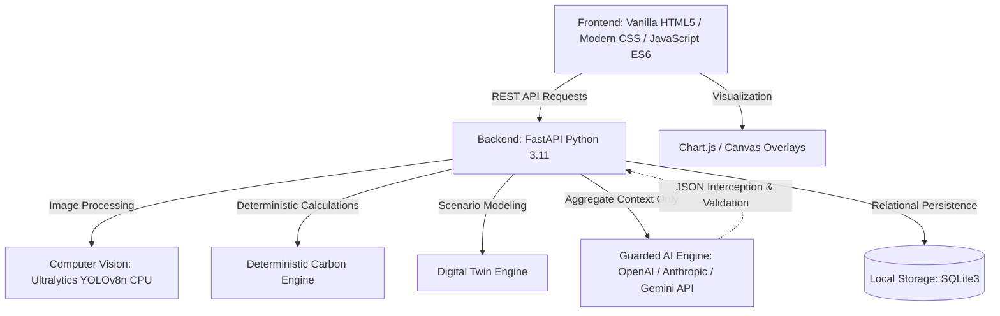

# TraceTwin: Campus Commute Emissions Intelligence Platform

> **Tagline:** See the traffic. Trace the carbon. Test the fix.

---

## 1. Executive Overview

**TraceTwin** is an environmental data intelligence platform designed for university campuses to quantify, analyze, and simulate interventions for commute-related vehicular carbon emissions. 

Universities generate significant Scope 3 greenhouse gas (GHG) emissions through daily student, faculty, and staff commuting. However, sustainability officers, campus planners, and student environmental bodies struggle with three fundamental obstacles:
1. **The Invisibility of Commute Activity:** Commute data is fragmented across physical parking lots, disconnected student registers, and sporadic surveys.
2. **Methodological Confusion:** Organizations frequently confuse snapshot parking observations with total daily unique commuters, misapply passenger-level emission factors to vehicle-kilometres, or rely on unsupported extrapolations.
3. **Inability to Test Interventions Before Implementation:** Campus administrators lack accessible "Digital Twin" simulation tools to evaluate the real-world carbon impact of policies—such as carpooling initiatives, transit shuttles, or hybrid schedule adjustments—prior to committing capital and operational resources.

TraceTwin resolves these challenges through an integrated, defensible five-stage workflow:
$$\text{Campus Parking Photos} \longrightarrow \text{Pretrained CV Detection} \longrightarrow \text{Human Verification} \longrightarrow \text{Deterministic Carbon Engine} \longrightarrow \text{Digital Twin Scenario Engine} \longrightarrow \text{Guarded AI Policy Explanations}$$

### The Core Architectural Principle
> **AI may detect objects and explain results, but deterministic calculations and documented emission factors must control all numerical emissions claims.**

---

## 2. Event & Regulatory Context

| Attribute | Specification |
| :--- | :--- |
| **Event** | Dayananda Sagar University Code Clash 2.0 Hackathon |
| **Dates** | October 15–16, 2026 |
| **Track** | Carbon Footprint Intelligence Platform |
| **Target Deployment** | Single local laptop (self-contained local demonstration) |
| **Primary Audience** | Hackathon evaluators, campus sustainability committees, university facility planners |

### Critical Hackathon Constraint
The official event website states that **all code must be written during the event** and that **pre-built projects or templates are strictly prohibited**.

To preserve full compliance with the hackathon regulations:
- **No executable application code has been generated prior to kickoff.** This repository contains only architecture specifications, product requirements, data schemas, mathematical methodologies, decision logs, and execution roadmaps.
- **No starter repos, boilerplate files, or hidden scripts exist.** All application logic, APIs, frontend layouts, and database migrations will be authored during the active 48-hour hackathon window.
- **AI Coding Assistance:** While AI coding tools are permitted as collaborative pair-programmers during the hackathon, their output is strictly bounded to the live hackathon hours and must be reviewed, tested, and integrated by the team.

---

## 3. Scope & Baseline Boundaries

To maintain scientific credibility and deliver an airtight 48-hour minimum viable product (MVP), TraceTwin enforces strict scope boundaries:

### Supported Vehicle Categories
1. **Cars** (Personal passenger automobiles, internal combustion engines)
2. **Motorcycles and scooters** (Two-wheelers powered by petrol)
3. **Buses and campus shuttles** (Contracted institutional shuttles or mass transit buses)
4. **Other fuel-burning vehicles, including auto-rickshaws** (Three-wheelers and utility vehicles)

### Explicit Baseline Exclusions
- **Electric Vehicles (EVs):** Excluded from the initial baseline calculation. Incorporating EVs requires grid-carbon intensity data (e.g., Central Electricity Authority emission factors) and charging behavior models that fall outside the 48-hour core scope.
- **Walking & Cycling:** Non-motorized active transit produces zero tailpipe emissions. While active transport is noted as a desirable target state, it is excluded from emissions accounting to avoid artificial baseline distortion.
- **Lifecycle & Upstream Emissions (Well-to-Tank):** The MVP strictly calculates **direct tailpipe greenhouse gas emissions ($CO_2$)**. Full lifecycle lifecycle assessment (LCA) and upstream fuel refining emissions are explicitly documented as out of scope.

---

## 4. Documentation Suite Index

The planning and engineering of TraceTwin is documented across eleven interconnected specifications housed in this directory:

| Document | Purpose |
| :--- | :--- |
| [README.md](./README.md) | Project orientation, scope boundaries, hackathon compliance, and quick start. |
| [PRD.md](./PRD.md) | Product Requirements Document: user personas, functional/non-functional specs, acceptance criteria. |
| [SPECIFICATIONS.md](./SPECIFICATIONS.md) | Technical architecture, API contracts, CV pipeline, UI layouts, and Guarded AI specs. |
| [CONTEXT.md](./CONTEXT.md) | Concise developer context, invariant mathematical rules, and assistant instructions. |
| [STATUS.md](./STATUS.md) | Live tracking of confirmed decisions, proposals, blockers, risks, and audit trail. |
| [DECISIONS.md](./DECISIONS.md) | Architectural Decision Records (ADRs) with rationale, consequences, and open concerns. |
| [DATA_DICTIONARY.md](./DATA_DICTIONARY.md) | Conceptual entity models, attribute definitions, provenance tags, and privacy flags. |
| [METHODOLOGY.md](./METHODOLOGY.md) | Exhaustive carbon accounting methodology, formulas, unit checks, and bias mitigation. |
| [TEST_PLAN.md](./TEST_PLAN.md) | Comprehensive test suite covering CV, mathematics, AI safeguards, edge cases, and privacy. |
| [EXECUTION_PLAN.md](./EXECUTION_PLAN.md) | 48-hour workstream roadmap, vertical slices, cut lines, and role definitions. |
| [SOURCES_AND_ASSUMPTIONS.md](./SOURCES_AND_ASSUMPTIONS.md) | Emission factor register, source verification notes, assumptions, and literature analysis. |
| [VALIDATION_SUMMARY.md](./VALIDATION_SUMMARY.md) | Cross-document consistency audit, checklist verification, and unresolved decisions. |

---

## 5. Proposed Technology Stack

> **Status:** `Proposed` (Subject to live setup during hackathon kickoff)

- **Frontend Client:** Lightweight Vanilla HTML5, modern custom CSS (clean dark mode, responsive flex/grid layouts), and native JavaScript (ES6+). Zero heavy frontend frameworks (no React/Next.js/Angular) to guarantee rapid live development, zero build-step overhead, and instant browser debugging.
- **Data Visualizations:** Chart.js for interactive emission breakdown charts and scenario comparisons; HTML5 Canvas for bounding box rendering and human verification.
- **Backend Application Server:** Python 3.11 with FastAPI and Uvicorn. Provides asynchronous request handling, automated OpenAPI documentation, Pydantic type safety, and seamless Python ML integration.
- **Computer Vision Pipeline:** Ultralytics YOLOv8 (nano variant `yolov8n.pt`) executing locally on CPU. Designed for rapid detection of cars, motorcycles, and buses from parking snapshot photographs.
- **Persistence Tier:** SQLite3 running locally via SQLAlchemy ORM or standard Python `sqlite3`. Zero configuration, zero external database daemon.
- **Guarded Generative AI:** API-based LLM (OpenAI GPT-4o-mini, Anthropic Claude 3.5 Haiku, or Google Gemini 1.5 Flash). Enforces strict JSON schemas, receives only aggregate metrics (no PII), and operates behind a deterministic validation gate with an automatic rule-based fallback.

---

## 6. How the Team Should Use This Documentation

1. **Pre-Hackathon Preparation:**
   - Review [CONTEXT.md](./CONTEXT.md) to internalize the core boundaries, mathematical formulas, and anti-hallucination rules.
   - Clarify unresolved items listed in [STATUS.md](./STATUS.md) and [VALIDATION_SUMMARY.md](./VALIDATION_SUMMARY.md).
2. **Kickoff (Hour 0):**
   - Confirm team workstream assignments as detailed in [EXECUTION_PLAN.md](./EXECUTION_PLAN.md).
   - Freeze the shared API contract from [SPECIFICATIONS.md](./SPECIFICATIONS.md).
3. **During Live Implementation:**
   - Adhere strictly to the field names and validation rules defined in [DATA_DICTIONARY.md](./DATA_DICTIONARY.md).
   - Implement the exact mathematical formulas documented in [METHODOLOGY.md](./METHODOLOGY.md).
   - Execute verification tests outlined in [TEST_PLAN.md](./TEST_PLAN.md) before declaring features complete.
4. **During the Final Presentation:**
   - Use the methodology disclosures and evidence labeling system to demonstrate scientific maturity and transparency to the evaluators.

---

## 7. Status & Testing Notice

> [!IMPORTANT]
> **Documentation Does Not Equal Implementation or Verification.**
> - All architectural diagrams, API schemas, UI mockups, and database tables described in this documentation suite represent **proposed specifications**.
> - No functional software has been deployed, and no physical tests have been executed prior to the hackathon.
> - As features are built and validated during the active competition, their status will transition from `Proposed` to `Implemented` and `Tested` in [STATUS.md](./STATUS.md) only upon provision of verifiable execution evidence.
