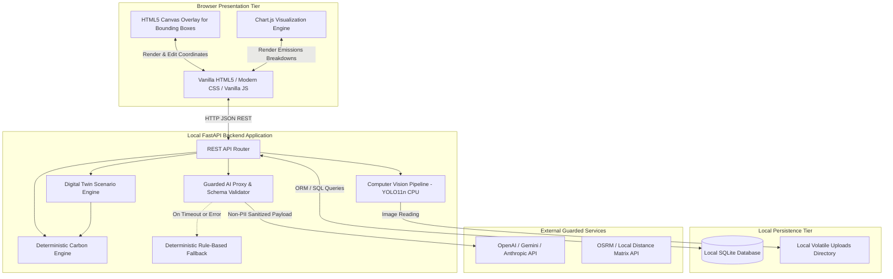
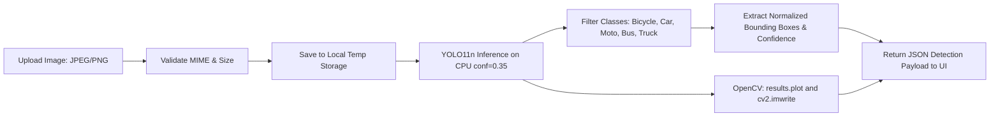

# Technical Specifications & System Architecture — TraceTwin

**Document Status:** `Proposed`  
**Current Stage:** Architecture & Design  
**Last Updated:** October 15, 2026  
**Authors:** TraceTwin System Architecture Team  

> [!IMPORTANT]
> **Specification Notice:** All architectures, endpoints, data contracts, and schemas in this document represent **proposals for implementation during the hackathon**. In accordance with event regulations prohibiting pre-built projects, no executable application code or database scripts exist prior to the competition kickoff.

---

## 1. System Overview & Proposed Architecture

TraceTwin is structured as a modular, lightweight, single-laptop client-server application. It emphasizes rapid local execution, high reliability, zero cloud deployment complexity, and strict mathematical defensibility.



---

## 2. Tier Responsibilities

### 2.1 Frontend Presentation Tier (Web Browser)
- **Zero-Build Architecture:** Built using native browser technologies (HTML5, Vanilla CSS3, ES6+ JavaScript) loaded directly via browser or static file server.
- **Interactive Verification Canvas:** Renders uploaded parking images with dynamically drawn SVG/Canvas bounding boxes. Captures mouse clicks to delete, drag, resize, or reclassify detected vehicle boxes.
- **Dynamic Scenario Controls:** Interactive range sliders and input steppers for real-time Digital Twin simulation adjustments.
- **Evidence-Tagged UI:** Every displayed emissions value and metric automatically renders its corresponding evidence tag (e.g., `[Human-confirmed observation]`, `[Derived calculation]`).
- **Audit Methodology Panel:** An accessible drawer or modal exposing active formulas, emission factor citations, geographic scopes, and sample size warnings.

### 2.2 Backend Application Server (FastAPI / Python 3.11)
- **API Routing & Parameter Validation:** Asynchronous endpoints utilizing Pydantic models to enforce strict data types, positive numerical bounds, and enumerated categories.
- **Computer Vision Inference:** Loads the pretrained `yolo11n.pt` model into memory on startup. Executes CPU-based object detection on uploaded images, serializes bounding boxes, and generates OpenCV annotated image plots.
- **Deterministic Carbon Accounting:** Pure Python mathematical module responsible for vehicle-kilometre and emissions calculations. Absolutely decoupled from the AI tier.
- **Digital Twin Simulation Engine:** Recomputes travel activities under adjusted scenario parameters, applying rebound penalties (e.g., carpool detour distance, shuttle diesel fuel burn).
- **AI Safeguard & Fallback Proxy:** Intercepts LLM calls, constructs non-PII aggregate prompts, enforces structured JSON responses, verifies recommendation IDs, and automatically activates the rule-based fallback if latency exceeds 4,000 ms.

### 2.3 Storage Tier (Local SQLite3)
- Self-contained relational database file stored locally (`tracetwin.db`).
- Handles assessment configurations, parking observations, verified detection counts, commute parameters, baseline runs, and scenario results.
- **Privacy Rule:** Strictly prohibits storing student names, student IDs, exact street addresses, or raw attendance logs.

---

## 3. Computer Vision Pipeline Specification



### 3.1 Model Selection & Justification
- **Model:** Ultralytics YOLO11 Nano (`yolo11n.pt`).
- **Weight Size:** ~5.4 MB (ultra-lightweight, automatic download on first initialization).
- **Target Execution Device:** Host CPU (Intel Core i5/i7 or AMD Ryzen equivalent; no CUDA GPU required).
- **Inference Latency:** Estimated 1.5 – 3.0 seconds per $1920 \times 1080$ image on standard modern laptop CPU.
- **Image Annotation Pipeline:** Uses `results[0].plot()` and OpenCV (`cv2.imwrite("detected_vehicles.jpg", annotated_image)`) to generate annotated visualization plots directly on disk.

### 3.2 Category Mapping & Class Reconciliation
The standard COCO dataset contains 80 classes. TraceTwin filters and maps raw COCO detection IDs to the platform's categories:

| COCO Class ID | COCO Class Name | TraceTwin Category Target | Handling Notes |
| :---: | :--- | :--- | :--- |
| `1` | `bicycle` | *Active Transit Observation* | Detected and counted in vehicle summary; rendered on canvas in Cyan (`#06b6d4`). **Excluded from tailpipe carbon emissions calculation** as zero-emission active transit. |
| `2` | `car` | **Cars** | Standard passenger sedans, hatchbacks, SUVs. Mapped to Category 1. |
| `3` | `motorcycle` | **Motorcycles and scooters** | Two-wheelers powered by petrol. Mapped to Category 2. |
| `5` | `bus` | **Buses and campus shuttles** | Institutional buses, public transit coaches. Mapped to Category 3. |
| `7` | `truck` | **Other fuel-burning vehicles** | Mapped as proxy for light commercial delivery vans and utility vehicles. |
| *None* | *Auto-rickshaw* | **Other fuel-burning vehicles** | Pretrained COCO models often misclassify auto-rickshaws as cars or trucks. The human verification loop allows the user to reclassify these to "Other fuel-burning vehicles". |
| `1` | `bicycle` | *Excluded / Filtered* | Non-motorized active transit is excluded from baseline. Flagged as informational or ignored. |

### 3.3 Human Verification Loop Workflow
1. **Render:** The frontend displays the image with color-coded bounding rectangles (e.g., Blue for Cars, Orange for Two-Wheelers, Green for Buses, Purple for Other).
2. **Review:** The user visually audits the detections against the physical image.
3. **Edit Operations:**
   - **Delete Box:** Clicking a detection and pressing `Delete` or clicking an "X" icon removes false positives (e.g., shadows or parked bicycles misclassified as motorcycles).
   - **Reclassify:** Selecting a box displays a dropdown to reassign its class (e.g., converting a misidentified auto-rickshaw from "Car" to "Other fuel-burning vehicles").
   - **Add Box:** User clicks and drags across an unspotted vehicle to create a new bounding box and chooses the category.
4. **Confirm:** User clicks "Confirm Verification". The backend writes the verified counts to the database with the evidence label `[Human-confirmed observation]`.

---

## 4. Deterministic Carbon Engine Specification

The calculation engine must operate as pure, side-effect-free Python functions with absolute unit consistency.

### 4.1 Input Parameters per Category ($k$)
- $N_k$: Daily commuting vehicles count (vehicles/day)
- $D_k$: Average one-way commute distance (km/trip)
- $Y$: Academic commuting days per year (days/year, default: 200)
- $EF_k$: Emission factor ($\text{kg } CO_2/\text{veh-km}$)

### 4.2 Invariant Formulas
$$\text{VKT}_k (\text{km/year}) = N_k \times D_k \times 2 \times Y$$
$$\text{Emissions}_k (\text{kg } CO_2/\text{year}) = \text{VKT}_k \times EF_k$$
$$\text{Total Baseline } (t CO_2/\text{year}) = \frac{\sum_{k} \text{Emissions}_k}{1000}$$

### 4.3 Validation Guardrails
- Input values must satisfy: $N_k \ge 0$, $D_k > 0$, $Y \ge 1$.
- Negative results or division-by-zero operations are trapped before execution.
- If $N_k = 0$, emissions for category $k$ evaluate strictly to $0.00$.

---

## 5. Digital Twin Scenario Simulation Specifications

The scenario engine recalculates total emissions across the three approved interventions:

### 5.1 Scenario 1: Fewer Commute Days (Remote Schedule)
- **User Input:** Percentage reduction in on-campus travel days ($P_{\text{remote}} \in [0.0, 0.50]$).
- **Recalculation:**
  $$Y_{\text{scenario}} = Y_{\text{baseline}} \times (1 - P_{\text{remote}})$$
  $$\text{VKT}_{k,\text{scenario}} = N_k \times D_k \times 2 \times Y_{\text{scenario}}$$
  $$\text{Emissions}_{\text{scenario}} = \sum_k \left( \text{VKT}_{k,\text{scenario}} \times EF_k \right) \div 1000$$
  $$\text{Net Avoided } (t CO_2) = \text{Total Baseline} - \text{Emissions}_{\text{scenario}}$$

### 5.2 Scenario 2: Carpooling Incentive
- **User Input:** Carpool shift percentage of solo car drivers ($S_{\text{pool}} \in [0.0, 0.60]$); Target carpool vehicle occupancy ($O_{\text{pool}}$, default: 2.5 persons/car).
- **Detour Penalty Factor:** $D_{\text{detour}} = 1.10$ (10% additional route distance for passenger pickup).
- **Recalculation:**
  - Solo car drivers shifting: $N_{\text{shift}} = N_{\text{car}} \times S_{\text{pool}}$
  - New carpool vehicles required: $N_{\text{pool\_veh}} = \lceil N_{\text{shift}} / O_{\text{pool}} \rceil$
  - Net car fleet: $N_{\text{car,\ scenario}} = (N_{\text{car}} - N_{\text{shift}}) + N_{\text{pool\_veh}}$
  - Adjusted average distance for pooled fleet: $D_{\text{car,\ scenario}} = D_{\text{car}} \times \left( (1 - S_{\text{pool}}) + S_{\text{pool}} \times D_{\text{detour}} \right)$
  - Recompute car VKT and emissions; all other categories remain constant.

### 5.3 Scenario 3: Institutional Bus / Campus Shuttle Intervention
- **User Input:** Number of shuttle routes ($R$), daily roundtrips per route ($T_{\text{trips}}$), one-way route distance ($D_{\text{shuttle}}$), commuters shifted from private modes ($M_{\text{shifted}}$).
- **Avoided Private Emissions:**
  - Reduce private car and motorcycle vehicle counts proportionally to absorbed commuters.
  - Compute avoided private VKT and avoided private emissions.
- **Added Shuttle Emissions (CRITICAL REQUIREMENT):**
  $$\text{VKT}_{\text{shuttle}} = R \times T_{\text{trips}} \times (D_{\text{shuttle}} \times 2) \times Y$$
  $$\text{Added Emissions}_{\text{shuttle}} (\text{kg } CO_2) = \text{VKT}_{\text{shuttle}} \times EF_{\text{shuttle}}$$
- **Net Scenario Balance:**
  $$\text{Net Avoided } (t CO_2) = \frac{\text{Avoided Private Emissions} - \text{Added Shuttle Emissions}}{1000}$$
  *If Added Shuttle Emissions > Avoided Private Emissions, Net Avoided is negative, indicating the intervention increases campus emissions.*

---

## 6. Guarded AI Recommendation Safety Specification

To prevent hallucinations, the Generative AI service is strictly isolated from numerical calculation authority.

```mermaid
flowchart TD
    A[Scenario Engine Output: Tonnes CO2, Mode Splits] --> B[Sanitize Context: Strip PII, Format Aggregates]
    B --> C[Construct Constrained Prompt with Fixed Schema]
    C --> D[Dispatch to LLM API with 4000ms Timeout]
    D -->|Success within Timeout| E[Parse JSON Response]
    D -->|Timeout or Network Exception| F[Activate Deterministic Fallback Engine]
    E --> G{Validate Schema & Recommendation IDs}
    G -->|Valid & No Hallucinated Numbers| H[Attach Deterministic Engine Numbers to Recommendations]
    G -->|Invalid Schema or Unapproved Claims| F
    F --> I[Render Rule-Based Plan: 'Rule-based plan (AI unavailable)']
    H --> J[Render Guarded AI Plan to User Dashboard]
    I --> J
```

### 6.1 Strict LLM Prompt Architecture
```text
System Instruction:
You are an environmental policy analyst assistant for the TraceTwin campus emissions platform.
You will be provided with an aggregate carbon assessment summary.
Your role is to explain and rank policy interventions using ONLY qualitative rationale and approved action steps.
CRITICAL RULES:
1. You MUST NOT calculate, invent, adjust, or mention numerical emissions quantities, percentages, or financial costs.
2. All numerical emissions figures will be injected by our deterministic calculation engine.
3. You must select recommendations ONLY from the approved catalog:
   - REC_REMOTE_01: Compressed Academic Scheduling
   - REC_POOL_01: Designated High-Occupancy Vehicle Parking
   - REC_POOL_02: Campus Ride-Matching Network
   - REC_SHUTTLE_01: High-Density Feeder Shuttle Route
   - REC_SHUTTLE_02: First-Mile / Last-Mile Transit Partnership
4. Return ONLY a valid JSON array matching the specified schema.
```

### 6.2 Deterministic Fallback Catalog
If the LLM fails, times out, or returns invalid JSON, the system loads predefined expert rules:

| Condition Trigger | Fallback Recommendation ID | Fallback Title | Rule-Based Rationale |
| :--- | :--- | :--- | :--- |
| Car emissions > 60% of total | `REC_POOL_01` | Dedicated Carpool Parking Priority | Single-occupancy cars represent the largest emissions share. Prioritizing front-row parking for verified carpools provides an immediate, low-cost mode shift incentive. |
| Average distance > 15 km | `REC_SHUTTLE_01` | High-Density Transit Feeder Corridors | Long-distance suburban commuters contribute disproportionately to VKT. High-capacity shuttles along major transit corridors consolidate long trips effectively. |
| Operating days = 200 | `REC_REMOTE_01` | Compressed Academic Timetabling | Transitioning one day per fortnight to asynchronous digital learning reduces campus-wide commute trips by up to 10% without infrastructure expenditure. |

---

## 7. Proposed REST API Endpoints

> **Status:** `Proposed` (Subject to live authoring during hackathon)

### 7.1 Assessment Management
- **`POST /api/assessments`**
  - **Purpose:** Create a new assessment workspace.
  - **Request Body (JSON):**
    | Field | Type | Required | Description |
    | :--- | :--- | :---: | :--- |
    | `assessment_name` | string | Yes | Name of audit (e.g., "DSU Autumn 2026") |
    | `campus_area` | string | Yes | Target parking lot or zone |
    | `reporting_period` | string | Yes | e.g., "Academic Year 2026-27" |
    | `annual_days` | integer | Yes | Academic days (default: 200) |
  - **Response (JSON):** `{"assessment_id": "ast_9823", "status": "created"}`

### 7.2 Computer Vision & Verification
- **`POST /api/assessments/{id}/images`**
  - **Purpose:** Upload parking photograph and execute YOLO detection.
  - **Payload:** `multipart/form-data` containing `file` (JPEG/PNG).
  - **Response (JSON):**
    ```json
    {
      "image_id": "img_01",
      "width": 1920,
      "height": 1080,
      "detections": [
        {
          "detection_id": "det_01",
          "category": "Cars",
          "confidence": 0.89,
          "box": {"x_min": 120, "y_min": 340, "x_max": 280, "y_max": 490}
        }
      ],
      "snapshot_summary": {"Cars": 1, "Motorcycles and scooters": 0, "Buses and campus shuttles": 0, "Other fuel-burning vehicles": 0}
    }
    ```

- **`POST /api/assessments/{id}/verify`**
  - **Purpose:** Submit human-audited vehicle counts.
  - **Request Body (JSON):**
    | Field | Type | Required | Description |
    | :--- | :--- | :---: | :--- |
    | `image_id` | string | Yes | Associated image ID |
    | `verified_counts` | object | Yes | Key-value pairs for all 4 categories |
    | `reviewer_notes` | string | No | Optional audit justification |
  - **Response (JSON):** `{"status": "confirmed", "evidence_label": "Human-confirmed observation"}`

### 7.3 Commute Activity & Calculation
- **`POST /api/assessments/{id}/commute-inputs`**
  - **Purpose:** Ingest aggregate commute inputs from surveys or institutional records.
  - **Request Body (JSON):**
    ```json
    {
      "sample_size": 18,
      "population_total": 4500,
      "mode_data": [
        {"category": "Cars", "daily_vehicles": 14, "avg_one_way_km": 15.2, "occupancy": 1.1},
        {"category": "Motorcycles and scooters", "daily_vehicles": 22, "avg_one_way_km": 11.5, "occupancy": 1.0},
        {"category": "Buses and campus shuttles", "daily_vehicles": 2, "avg_one_way_km": 18.0, "occupancy": 35.0},
        {"category": "Other fuel-burning vehicles", "daily_vehicles": 4, "avg_one_way_km": 8.0, "occupancy": 1.8}
      ]
    }
    ```
  - **Response (JSON):** Detailed baseline emissions payload including total VKT, category emissions in $\text{kg } CO_2$ and tonnes, and evidence citations.

### 7.4 Digital Twin & AI Explanations
- **`POST /api/assessments/{id}/simulate`**
  - **Purpose:** Compute scenario comparisons and retrieve guarded AI recommendations.
  - **Request Body (JSON):** Scenario configuration parameters ($P_{\text{remote}}$, $S_{\text{pool}}$, $R_{\text{shuttle}}$, etc.).
  - **Response (JSON):** Comparative table of baseline vs. scenario emissions, net savings ($t CO_2$), and guarded policy recommendation cards with fallback tags.

---

## 8. Proposed Relational Schema (SQLite)

> **Status:** `Proposed` (Conceptual relational schema; no pre-built SQL scripts generated)

### 8.1 Table: `assessments`
- `assessment_id` (TEXT, Primary Key)
- `name` (TEXT, Not Null)
- `campus_area` (TEXT, Not Null)
- `reporting_period` (TEXT, Not Null)
- `annual_days` (INTEGER, Not Null, Default 200)
- `created_at` (TIMESTAMP)

### 8.2 Table: `parking_observations`
- `observation_id` (TEXT, Primary Key)
- `assessment_id` (TEXT, Foreign Key $\rightarrow$ `assessments.assessment_id`)
- `image_path` (TEXT, Not Null)
- `capture_timestamp` (TIMESTAMP)
- `verified_cars` (INTEGER, Default 0)
- `verified_motorcycles` (INTEGER, Default 0)
- `verified_buses` (INTEGER, Default 0)
- `verified_other` (INTEGER, Default 0)
- `verification_status` (TEXT, Default 'Pending')
- `reviewer_role` (TEXT)

### 8.3 Table: `commute_inputs`
- `input_id` (TEXT, Primary Key)
- `assessment_id` (TEXT, Foreign Key $\rightarrow$ `assessments.assessment_id`)
- `category` (TEXT, Not Null)
- `daily_vehicles` (REAL, Not Null)
- `avg_one_way_km` (REAL, Not Null)
- `occupancy_ratio` (REAL, Default 1.0)
- `source_stream` (TEXT, Not Null) -- e.g., 'Survey', 'Admin Register'
- `sample_size` (INTEGER)

### 8.4 Table: `emission_factors`
- `factor_id` (TEXT, Primary Key)
- `category` (TEXT, Not Null)
- `vehicle_type_detail` (TEXT)
- `value_kg_co2_per_vkt` (REAL, Not Null)
- `geography` (TEXT, Not Null)
- `source_title` (TEXT, Not Null)
- `source_url` (TEXT)
- `version_date` (TEXT)
- `is_active` (BOOLEAN, Default 1)

### 8.5 Table: `scenario_runs`
- `run_id` (TEXT, Primary Key)
- `assessment_id` (TEXT, Foreign Key $\rightarrow$ `assessments.assessment_id`)
- `scenario_type` (TEXT, Not Null) -- 'RemoteDays', 'Carpool', 'Shuttle'
- `input_parameters_json` (TEXT, Not Null)
- `baseline_tonnes_co2` (REAL, Not Null)
- `scenario_tonnes_co2` (REAL, Not Null)
- `net_savings_tonnes_co2` (REAL, Not Null)
- `ai_recommendation_json` (TEXT)
- `fallback_activated` (BOOLEAN, Not Null)
- `executed_at` (TIMESTAMP)

---

## 9. Error Handling & Edge Cases

| Failure Scenario | System Behavior | HTTP Code | UI Presentation |
| :--- | :--- | :---: | :--- |
| **Invalid Image Upload** (e.g., corrupt file or `.exe`) | Reject file during MIME check; delete temporary buffer. | `400 Bad Request` | Red notification: "Invalid image format. Please upload a valid JPEG or PNG photograph." |
| **Zero Detections in Photo** | Accept image; render canvas with 0 boxes; prompt human to draw vehicles manually. | `200 OK` | Informational alert: "No vehicles detected automatically. Please draw bounding boxes manually." |
| **Negative Commute Distance** | Pydantic validation error rejects request. | `422 Unprocessable Entity` | Form field highlights red: "One-way distance must be greater than 0.0 km." |
| **LLM Service Timeout (>4000ms)** | Proxy aborts outbound request; loads rule-based recommendation catalog. | `200 OK` (with fallback payload) | Warning banner: "Rule-based plan (AI unavailable). Recommendations generated via deterministic policy rules." |
| **Shuttle Adds Net Emissions** | Engine calculates negative net savings ($Baseline < Scenario$); returns data honestly. | `200 OK` | Highlight in Amber/Red: "Caution: This shuttle configuration adds 4.2 t CO2 due to low passenger diversion." |

---

## 10. External Dependencies & Technical Unknowns

### 10.1 External Runtime Dependencies
- **Ultralytics YOLO Package (`ultralytics`):** Standard library supporting `yolo11n.pt` and PyTorch CPU binary.
- **OpenCV (`opencv-python`):** Required for image decoding, `results[0].plot()` rendering, and `cv2.imwrite("detected_vehicles.jpg")`.
- **Mapping Service (OSRM or Google Maps API):** Required only if live distance lookup is integrated. If disabled or unauthorized, system falls back to manual distance entry.
- **LLM API Service (OpenAI, Gemini, or Anthropic):** Requires valid API key stored in local environment variable (`OPENAI_API_KEY`). Fallback protects against rate-limits or offline status.

### 10.2 Technical Unknowns Requiring Hackathon Verification
- **CPU Inference Latency on Target Laptop:** Must measure exact execution time of `yolo11n.pt` on the specific host machine during Hour 1.
- **Auto-rickshaw Detection Rate:** Evaluate how reliably YOLO11n tags three-wheelers (often classified as `truck` or `car`). Validate that the manual canvas reclassification tool smoothly reassigns them to "Other fuel-burning vehicles".
- **Mapping API Data Transfer Clearance:** Confirm whether passing neighborhood postal centroids to a public routing API complies with institutional privacy constraints.
